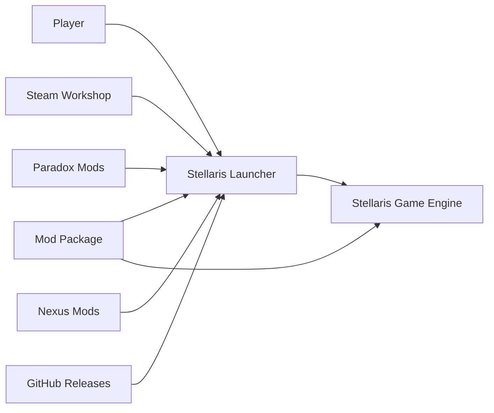
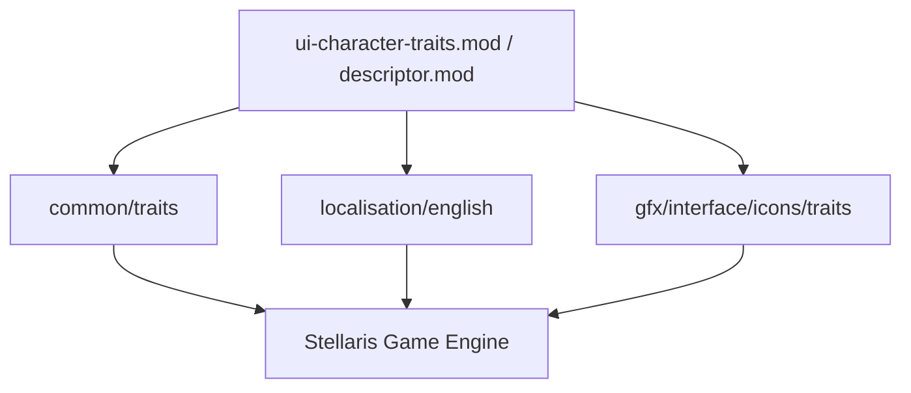
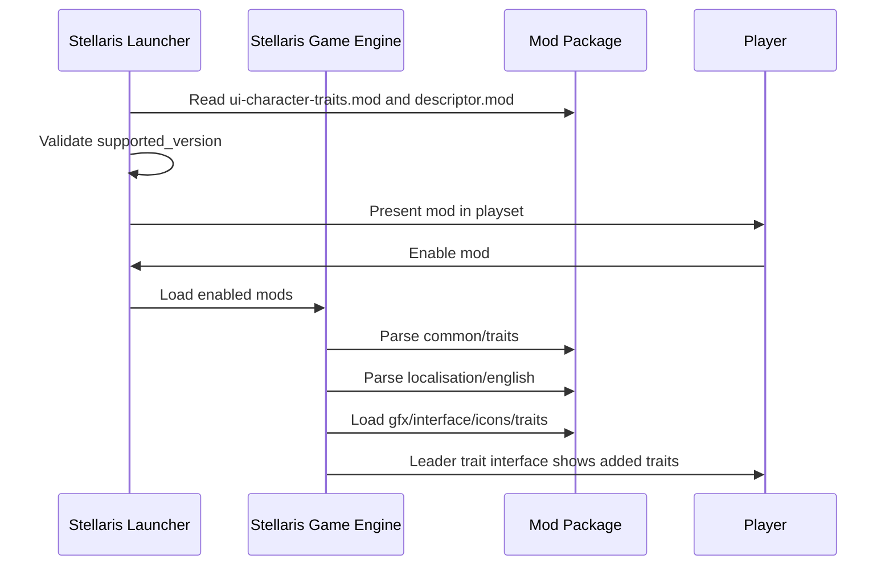
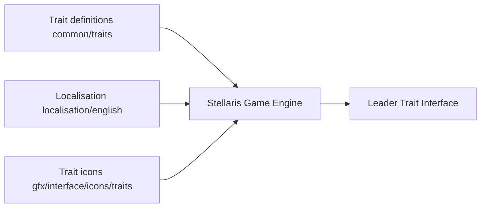
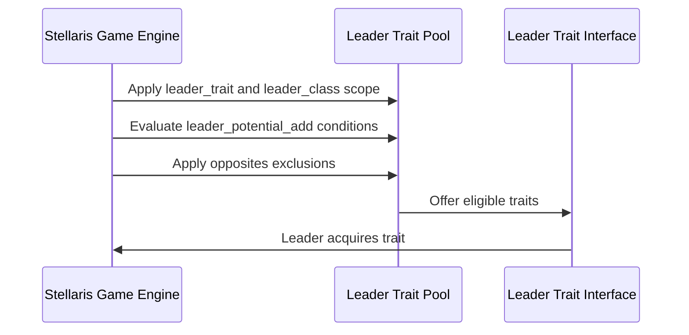
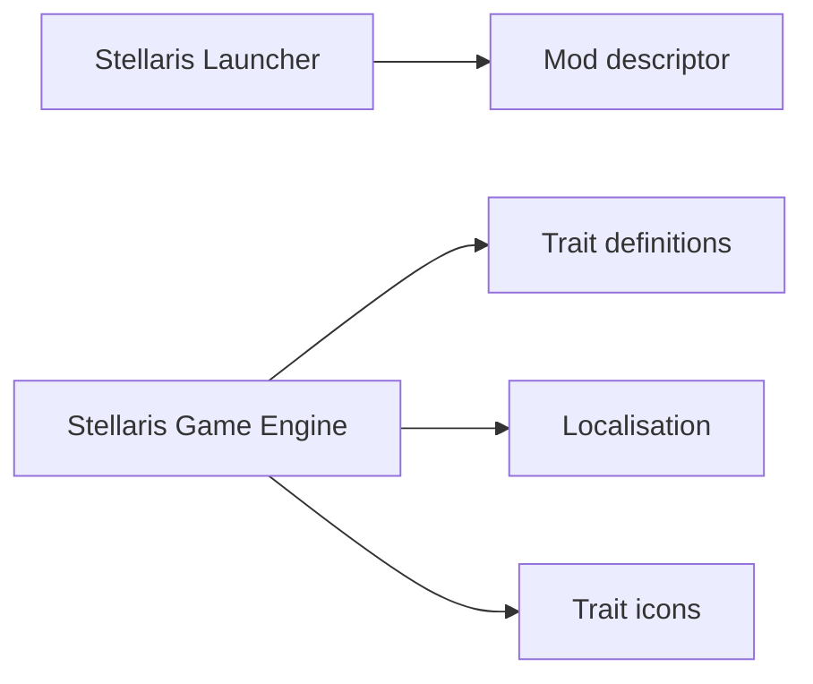

# Universum Infinitum - Character Traits Architecture

This document describes the current architecture of the Universum Infinitum - Character Traits mod for Stellaris. It covers the static content structure, the leader trait definition model, localisation and icon coupling, integration with the Stellaris engine at load time, and the constraints governing trait additions and distribution. It does not describe a target architecture.

## 📑 Table of Contents

- [Purpose](#purpose)
- [System Context](#system-context)
- [Architectural Style](#architectural-style)
- [Runtime Process](#runtime-process)
- [Architectural Areas](#architectural-areas)
  - [Descriptor Area](#descriptor-area)
  - [Leader Trait Definition Area](#leader-trait-definition-area)
  - [Localisation Area](#localisation-area)
  - [Trait Icon Area](#trait-icon-area)
- [Data Architecture](#data-architecture)
- [Interfaces and Integrations](#interfaces-and-integrations)
- [Key Processes](#key-processes)
  - [Leader Trait Acquisition](#leader-trait-acquisition)
- [Trait Definition Model](#trait-definition-model)
- [Cross-Cutting Concerns](#cross-cutting-concerns)
  - [Security and Privacy](#security-and-privacy)
  - [Error Handling](#error-handling)
  - [Observability](#observability)
  - [Configuration](#configuration)
- [Dependency Direction and Rules](#dependency-direction-and-rules)
- [External Dependencies](#external-dependencies)
- [Deployment and Operations](#deployment-and-operations)
- [Compatibility Contracts](#compatibility-contracts)
- [Testing and Verification](#testing-and-verification)
- [Design Constraints](#design-constraints)
- [Extension Points](#extension-points)
  - [Adding a New Leader Trait](#adding-a-new-leader-trait)
- [Source Map](#source-map)
- [Related Documentation](#related-documentation)

## 🎯 Purpose

The mod extends Stellaris with additional leader traits, mapped onto the post-4.x leader model: `commander` leaders (fleet and army), `official`/`scientist` governors, and councilors including the empire ruler. Its architectural responsibility is to supply declarative trait definitions, their English localisation, and their icon assets so that the Stellaris engine can present and apply them during leader trait acquisition. The system boundary is a static data package: the repository ships no executable code, no build step, and no runtime service. The intended audience is maintainers and contributors who need to add, revise, or remove leader traits without breaking trait identity, localisation pairing, or icon resolution.

## 🌐 System Context

The mod is consumed by the Stellaris launcher and game engine. Distribution platforms deliver the packaged mod; the launcher registers it and the engine interprets its files at load time. The mod has no runtime process of its own and initiates no outbound interaction.

The principal external boundaries are:
- **Stellaris Launcher:** Reads `ui-character-traits.mod` and `ui-character-traits/descriptor.mod` to register the mod, validate `supported_version`, and present it in the playset interface.
- **Stellaris Game Engine:** Parses `common/traits/`, `localisation/english/`, and `gfx/interface/icons/traits/` at load time, resolves trait eligibility, and renders leader traits.
- **Distribution Platforms (Steam Workshop, Paradox Mods, Nexus Mods, GitHub Releases):** Host and deliver the packaged mod. The mod declares no platform-specific behaviour and contains no network logic.

## 🏗️ Architectural Style

The mod follows a **declarative data-driven plugin architecture**. All behaviour is expressed as static Clausewitz script trait definitions (`.txt`), YAML localisation (`.yml`), and DDS image assets (`.dds`). The Stellaris engine owns interpretation, gating, and presentation; the repository supplies content only. The consequences are that ownership is file-based and additive, that trait identity is encoded in identifiers rather than code, and that no migration or compatibility logic can be expressed inside the mod.

The principal architecture boundaries are:
- **Descriptor boundary:** `ui-character-traits.mod` and `ui-character-traits/descriptor.mod` declare mod identity, path, tags, and `supported_version`; they are the launcher-facing contract.
- **Trait definition boundary:** `common/traits/*.txt` owns trait identity, scoped modifiers, eligibility conditions, exclusions, sprite references, and selection weight.
- **Localisation boundary:** `localisation/english/*.yml` owns player-visible names and descriptions keyed by trait identifier.
- **Asset boundary:** `gfx/interface/icons/traits/*.dds` owns the icon textures, and `interface/ui_character_traits.gfx` owns the sprite definitions that expose them to trait definitions.

## 🔄 Runtime Process

The principal runtime sequence is:
1. The launcher reads `ui-character-traits.mod` and `ui-character-traits/descriptor.mod` and validates the declared `supported_version`.
2. The player enables the mod in the active playset.
3. The game engine starts and loads every enabled mod directory.
4. The engine parses the trait definitions in `common/traits/`, registering trait identifiers, costs, modifiers, leader class and class-scope restrictions, eligibility conditions, and mutual exclusions.
5. The engine loads the localisation entries that supply trait names and descriptions.
6. The engine resolves each trait's `trait/icon` inline script, looks up the named sprite, and loads the texture that sprite points at.
7. The leader interface presents the added traits subject to leader class, eligibility, and exclusion rules.

## 🗂️ Architectural Areas

### Descriptor Area

Paths:
- `ui-character-traits.mod`
- `ui-character-traits/descriptor.mod`

Responsibilities:
- Declare the mod name, in-archive path, tag list, and supported game version.
- Provide the single entry point recognised by the launcher.

Boundary rules:
- `ui-character-traits.mod` must remain at the repository root and `descriptor.mod` must remain inside the `ui-character-traits/` payload directory.
- The `path` field must agree with the payload directory name, since the launcher resolves the mod body through it.
- Both files are declarative; neither may gain executable content.

### Leader Trait Definition Area

Paths:
- `ui-character-traits/common/traits/ui-traits_leader.txt`
- `ui-character-traits/common/traits/ui-traits_leader_admiral.txt`
- `ui-character-traits/common/traits/ui-traits_leader_general.txt`
- `ui-character-traits/common/traits/ui-traits_leader_governor.txt`
- `ui-character-traits/common/traits/ui-traits_leader_ruler.txt`

Responsibilities:
- Define 47 leader traits: 6 admiral traits, 1 general trait, 34 governor traits, 5 ruler traits, and 1 class-agnostic leader trait.
- Own each trait's cost, modifiers, eligibility conditions, mutual exclusions, and leader class and class-scope restrictions.
- Reference trait icons by sprite name: either a sprite the mod declares in `interface/ui_character_traits.gfx` or a vanilla sprite supplied by the base game.

Boundary rules:
- Trait identifiers use the `ui_trait_` prefix; custom identifiers must not collide with vanilla `leader_trait_*` identifiers.
- `opposites` lists must reference existing trait identifiers, whether vanilla or custom.
- Trait definitions must not reference other mod files by path; coupling to localisation and assets occurs through identifier and icon reference only.
- Files are split by legacy leader class for readability, but a trait's effective scope is determined by its `leader_class`, its modifier block, and its `leader_potential_add` conditions, not by file placement.

### Localisation Area

Paths:
- `ui-character-traits/localisation/english/ui-traits_l_english.yml`

Responsibilities:
- Supply the English display name and description for each trait.
- Group entries by leader class using comment headings.

Boundary rules:
- The file must declare `l_english:` and use the `key:0 "value"` form.
- Localisation keys must match trait identifiers from the trait definition area.
- The file is stored as UTF-8 with a byte-order mark and uses `§!` and `\n` formatting inside description strings.
- Only English localisation is provided.

### Trait Icon Area

Paths:
- `ui-character-traits/gfx/interface/icons/traits/*.dds`
- `ui-character-traits/thumbnail.png`

Responsibilities:
- Provide 45 DDS icon assets and 44 sprite definitions; one icon (`ui_trait_governor_securist.dds`) is currently unreferenced.
- Provide the workshop and store thumbnail.

Boundary rules:
- Icons must be DDS format, as required by the engine.
- Icon files reside directly in `traits/` with no subdirectories.
- An icon is resolved only when a trait's `trait/icon` script names the corresponding sprite; the remaining files are inert assets until referenced.

## 💾 Data Architecture

The mod owns no persistent or mutable state at runtime. All content is static configuration loaded once by the engine at startup; trait availability, acquisition, and effects are engine-owned state derived from these definitions.

| Data or Store | Owner | Representation and Storage | Lifecycle or Consistency |
|---------------|-------|----------------------------|--------------------------|
| Trait definitions | Leader Trait Definition Area | Clausewitz script in `ui-character-traits/common/traits/` | Static; parsed once at game start |
| Localisation strings | Localisation Area | YAML in `ui-character-traits/localisation/english/` | Static; parsed once at game start; keys resolved against trait identifiers |
| Trait icons | Trait Icon Area | DDS images in `ui-character-traits/gfx/interface/icons/traits/` | Static; resolved on demand through `icon` references |
| Mod descriptor | Descriptor Area | Clausewitz script at repository root and in the payload directory | Static; read by the launcher before load |
| Thumbnail | Trait Icon Area | PNG at `ui-character-traits/thumbnail.png` | Static distribution metadata; not interpreted by the engine |

## 🔌 Interfaces and Integrations

| Interface or Integration | Direction | Contract | Owner | Failure Semantics |
|--------------------------|-----------|----------|-------|-------------------|
| Mod descriptor | Inbound | `name`, `path`, `tags`, `supported_version` in `.mod` files | Descriptor Area | Unreadable or version-mismatched descriptor leaves the mod unregistered or disabled by the launcher |
| Trait definitions | Inbound | Clausewitz trait blocks in `common/traits/*.txt` | Leader Trait Definition Area | Parse failure drops the affected trait; unknown identifiers in `opposites` leave exclusion unresolved |
| Localisation | Inbound | `l_english:` keys matching trait identifiers | Localisation Area | Missing key causes the raw identifier to be displayed instead of a name |
| Trait icons | Inbound | `ICON = "GFX_<sprite>"` inside the `trait/icon` inline script | Trait Icon Area | An unresolvable sprite falls back to a default or placeholder graphic |
| Distribution platforms | Inbound | Packaged mod archives delivered by the platform client | External | Out of the mod's control; the repository declares no platform-specific behaviour |

## 🔀 Key Processes

### Leader Trait Acquisition

Eligibility is evaluated by the engine against the trait definition, not by the mod. Of the 47 trait definitions, 36 declare a `leader_potential_add` block that gates the trait behind leader subclass, ruler status, ethics, authorities, an existing governor focus, or the absence of conflicting vanilla or custom traits; 38 declare an `opposites` block that removes mutually exclusive traits from the same offer. All 47 declare a `selectable_weight` block. Trait scope is enforced through `leader_class` and the chosen modifier block: 34 traits are planet-scoped governors available to `official`, `commander` and `scientist`; 6 are fleet-scoped `commander` traits gated on the admiral subclass; 1 is an army-scoped `commander` trait gated on the general subclass; 5 are councilor-scoped traits gated on ruler status or a councilor subclass; and 1 is a leader-scoped trait available to all three classes but excluding the ruler.

## ⚙️ Trait Definition Model

A leader trait is a single Clausewitz block keyed by its trait identifier. The fields observed across the 47 definitions are:

- `cost`: trait selection cost; every definition sets `1`.
- `inline_script` (`trait/icon` with `ICON`, `RARITY`, `COUNCIL`, `TIER`, `CLASS`): builds the layered icon; declared by all 47 definitions.
- `modifier`: a block of Stellaris static modifiers that the engine applies; declared by all 47 definitions.
- `leader_potential_add`: eligibility conditions evaluated against the leader, the country, or the leader's origin context; declared by 21 definitions.
- `<scope>_modifier` (`planet_modifier`, `fleet_modifier`, `army_modifier`, `councilor_modifier`, `self_modifier`): declared by all 47 definitions, exactly one each.
- `leader_class`: the leader classes the trait is offered to; declared by all 47 definitions.
- `opposites`: identifiers excluded from the same offer; declared by 37 definitions.
- `selectable_weight`: relative chance of being offered at level-up; declared by all 47 definitions.

Identifier conventions within the area are `ui_trait_leader_*` for class-agnostic traits, and `ui_trait_admiral_*`, `ui_trait_general_*`, `ui_trait_governor_*`, and `ui_trait_ruler_*` for class-scoped traits. Icon files follow a shorter convention and are named after the trait's theme rather than its full identifier, for example `ui_trait_berserker.dds` for `ui_trait_admiral_berserker`.

## 🧵 Cross-Cutting Concerns

### Security and Privacy

The mod introduces no trust boundary of its own: it performs no authentication, authorisation, input parsing, or network communication, and it stores no personal data. The security-relevant surface is content integrity and supply chain, since trait definitions and icon assets are executed as game content by the engine. For the vulnerability reporting and disclosure contract, see [SECURITY.md](./SECURITY.md); for the data handling statement, see [PRIVACY.md](./PRIVACY.md).

### Error Handling

The mod contains no error handling logic, since it contains no executable code. Failure is owned by the engine and the launcher: an unreadable or version-mismatched descriptor leaves the mod unregistered, an unparsable trait block drops that trait, an unresolvable `opposites` identifier leaves the exclusion unresolved, a missing localisation key surfaces the raw identifier, and an unresolvable sprite falls back to a default graphic. The repository's only mitigation is deliberate identifier pairing across the definition, localisation, and asset areas.

### Observability

No logging, metrics, or telemetry are emitted by the mod. Diagnostic signals are engine-owned and surface in the Stellaris error log and in-game tooltips, which report parse and reference problems caused by these content files. There is no repository-side diagnostic tooling for trait or localisation consistency.

### Configuration

| Configuration Area | Source | Responsibility | Supersede or Secret Policy |
|--------------------|--------|----------------|---------------------------|
| Mod identity and version gate | `ui-character-traits.mod`, `ui-character-traits/descriptor.mod` | Declares name, payload path, tags, and `supported_version` | No override mechanism; the launcher reads these values directly |
| Trait behaviour | `ui-character-traits/common/traits/*.txt` | Declares cost, modifiers, eligibility, exclusions, and visual reference | No environment or user override; values are literal |
| Player-visible text | `ui-character-traits/localisation/english/ui-traits_l_english.yml` | Declares names and descriptions | Selected by game language; only English is supplied |

The repository holds no secrets and no environment-dependent configuration.

## 🧭 Dependency Direction and Rules

Dependencies flow in one direction only, from the engine inward to static content files. The mod has no internal runtime dependency graph.

The principal dependency rules are:
- Trait definitions append to the engine's leader trait pool; they never replace or modify vanilla trait definitions.
- Trait definitions may depend on localisation and assets only through identifier and icon reference; localisation and assets must not be treated as the source of trait behaviour.
- Trait identifiers must remain unique against both the mod's own identifiers and vanilla `leader_trait_*` identifiers.
- Every trait definition must have a matching localisation name key and description key.
- Every `ICON` value must resolve either to a sprite the mod declares in `interface/ui_character_traits.gfx` or to a vanilla sprite supplied by the base game, and every mod sprite must point at a texture the mod ships.
- `opposites` entries must reference existing trait identifiers and must not introduce cycles that would make a trait unreachable.
- The descriptor area sits above all content areas: no content change is visible to the player unless the descriptor remains valid.

## 📦 External Dependencies

| Dependency | Responsibility | Integration Boundary | Architectural Consequence |
|------------|----------------|----------------------|---------------------------|
| Stellaris game engine | Parses trait definitions, resolves eligibility and exclusions, applies modifiers, and renders leader traits | Trait definition, localisation, and icon areas | Defines the entire supported field vocabulary; unsupported fields are ignored or rejected |
| Clausewitz script parser | Interprets `.txt` trait definitions and `.mod` descriptors | Descriptor and trait definition areas | Restricts the mod to declarative literals; no variables, loops, or expressions |
| Localisation parser | Interprets `.yml` localisation files | Localisation area | Requires exact key pairing and engine-compatible file encoding |
| DDS image loader | Loads trait icon images | Trait icon area | Locks icon assets to the DDS format with no runtime conversion |
| Vanilla trait catalogue | Supplies referenced vanilla trait identifiers and vanilla icons | Trait definition area | Creates a coupling to specific vanilla trait identifiers and icon names that must exist in the target game version |

## 🚀 Deployment and Operations

The mod is a static archive with no process topology, no persistent state, and no scaling behaviour. Deployment consists of placing the payload in a mod directory that the launcher scans.

| Concern | Current Design | Architectural Consequence |
|---------|----------------|---------------------------|
| Process topology | None; the mod is content loaded by the game process | No startup, shutdown, or lifecycle responsibility belongs to the repository |
| Deployment unit | The `ui-character-traits/` payload directory plus the root `.mod` descriptor | Manual extraction and platform-based installation deliver the same artefact |
| Distribution channels | Steam Workshop, Paradox Mods, Nexus Mods, and GitHub Releases | Channel metadata is maintained outside the repository; the payload is identical for all channels |
| Persistent state | None owned by the mod; playset enablement and save state belong to the game | Disabling or removing the mod affects existing saves that reference its traits |
| Recovery | Re-extraction of the payload or platform-managed reinstallation | No rollback mechanism exists inside the repository beyond repository history |
| Versioning | Git tags `v1.0`, `v1.0.1`, and `v1.0.2`; the descriptor declares `supported_version="v4.5.*"` | Release tags and the declared supported game version evolve independently and can disagree |

## 🛡️ Compatibility Contracts

| Contract | Owner | Invariant | Verification | Change Policy |
|----------|-------|-----------|--------------|---------------|
| Trait identifier | Leader Trait Definition Area | Identifier is stable and globally unique; renaming breaks saves, localisation, and mutual exclusions | Manual review; no automated check | Treat as immutable once released; introduce a new identifier instead of renaming |
| Trait identifier ↔ localisation keys | Leader Trait Definition Area and Localisation Area | Each trait has a name key and a `_desc` description key, and both must reuse the trait identifier verbatim | Manual review; mismatched keys surface the raw identifier in game | Add both keys whenever a trait is added; currently 2 traits lack a description key |
| Trait identifier ↔ icon reference | Leader Trait Definition Area and Trait Icon Area | Each `icon` value resolves to a shipped DDS file or to a vanilla icon | Manual review; unresolvable icons fall back to a default graphic | Reference an existing file when adding an icon; 34 of the 45 shipped icons are not referenced by any definition |
| `opposites` identifier | Leader Trait Definition Area | Every listed identifier exists and the exclusion relationship remains intentional | Manual review | Update the list when a referenced vanilla or custom trait changes |
| Vanilla identifier coupling | Leader Trait Definition Area | Vanilla `leader_trait_*` identifiers referenced in `opposites` and `leader_potential_add` must exist in the target game version | Manual review against the target game version | Re-verify on every supported game version change |
| Descriptor fields | Descriptor Area | `name`, `path`, `tags`, and `supported_version` remain present and mutually consistent | Launcher validation at load | Update `supported_version` when the supported game version changes |

## ✅ Testing and Verification

No automated test suite, build script, or continuous-integration workflow exists in this repository. Verification is manual and performed against a local Stellaris installation.

Manual verification covers: the descriptor is recognised by the launcher and the mod can be enabled; every trait in `common/traits/` appears in the leader trait interface with the expected name and description; eligibility conditions admit and reject leaders of the intended ethics, authorities, and classes; `opposites` exclusions prevent mutually exclusive traits from coexisting; modifiers take effect as declared; icon references render as intended, including the three governor traits that reuse vanilla icons; and the game error log reports no trait or localisation errors attributable to this mod.

No executable verification command or repository script exists to include here. Material coverage gaps are the absence of identifier, localisation, and icon reference checking; the presence of 34 unreferenced icon assets and 3 localisation entries without matching trait definitions; and the two traits missing a description key.

## ⚠️ Design Constraints

- **Engine-owned semantics:** Trait behaviour cannot be expressed as logic; only engine-recognised Clausewitz fields have effect.
- **Declarative literal values:** No variables, loops, conditionals, or computed values are available in trait definitions.
- **Identifier immutability:** Trait identifiers are effectively permanent, because localisation keys, `opposites` lists, save data, and icon naming all reference them.
- **Single localisation language:** Only English is supplied; additional languages require new locale directories and files.
- **Icon format lock-in:** DDS is mandatory for trait icons, with no runtime conversion.
- **Class-scoped files with class-agnostic enforcement:** File organisation follows leader classes, but effective scope is determined solely by `leader_trait` and `leader_class` values.
- **Declared version range:** The descriptors declare `supported_version="v4.5.*"`, so behaviour on other game versions is unverified and must be re-validated manually.
- **No consistency enforcement:** Identifier, localisation, and icon pairing is a convention upheld by review alone, and the current content set already contains unmatched localisation keys, unreferenced icons, and missing description keys.
- **No runtime modification:** Traits cannot be added, removed, or revised during gameplay; changes require a restart and affect save data that referenced them.

## 🔧 Extension Points

### Adding a New Leader Trait

1. Add a trait block to the leader-class file in `ui-character-traits/common/traits/` that matches the trait's leader class, or place a class-agnostic trait in `ui-traits_leader.txt`.
2. Add the trait's name key and `_desc` description key to `ui-character-traits/localisation/english/ui-traits_l_english.yml`.
3. Add or reuse an icon in `ui-character-traits/gfx/interface/icons/traits/` and reference it from the trait's `icon` field.
4. Revise any existing `opposites` lists that must exclude the new trait, and append the corresponding identifiers to the new trait's own `opposites` list.
5. Verify the trait in game, including eligibility, exclusion, modifier, and icon rendering behaviour.

The extension must preserve the `ui_trait_` identifier prefix, must not reuse an existing or vanilla `leader_trait_*` identifier, and must declare both `leader_trait` and `leader_class`. No registration step exists: the engine discovers trait definitions by parsing the payload directory.

## 🗺️ Source Map

| Area | Path |
|------|------|
| Descriptor | `ui-character-traits.mod`, `ui-character-traits/descriptor.mod` |
| Leader Trait Definitions | `ui-character-traits/common/traits/` |
| Localisation | `ui-character-traits/localisation/english/ui-traits_l_english.yml` |
| Trait Icons | `ui-character-traits/gfx/interface/icons/traits/` |
| Thumbnail | `ui-character-traits/thumbnail.png` |
| Distribution Assets | `.github/cover.png`, `.github/FUNDING.yml` |

## 📚 Related Documentation

- [README.md](./README.md) describes the project's purpose, installation channels, and compatibility statement.
- [CONTRIBUTING.md](./CONTRIBUTING.md) describes the contribution process, prerequisites, and local verification expectations.
- [CODE_OF_CONDUCT.md](./CODE_OF_CONDUCT.md) defines the conduct standards for project spaces.
- [SECURITY.md](./SECURITY.md) defines vulnerability reporting, supported distribution channels, and the disclosure policy that this document references for content integrity concerns.
- [PRIVACY.md](./PRIVACY.md) states that the mod requests, collects, transmits, and persists no personal data, which underpins the security and privacy posture recorded here.
