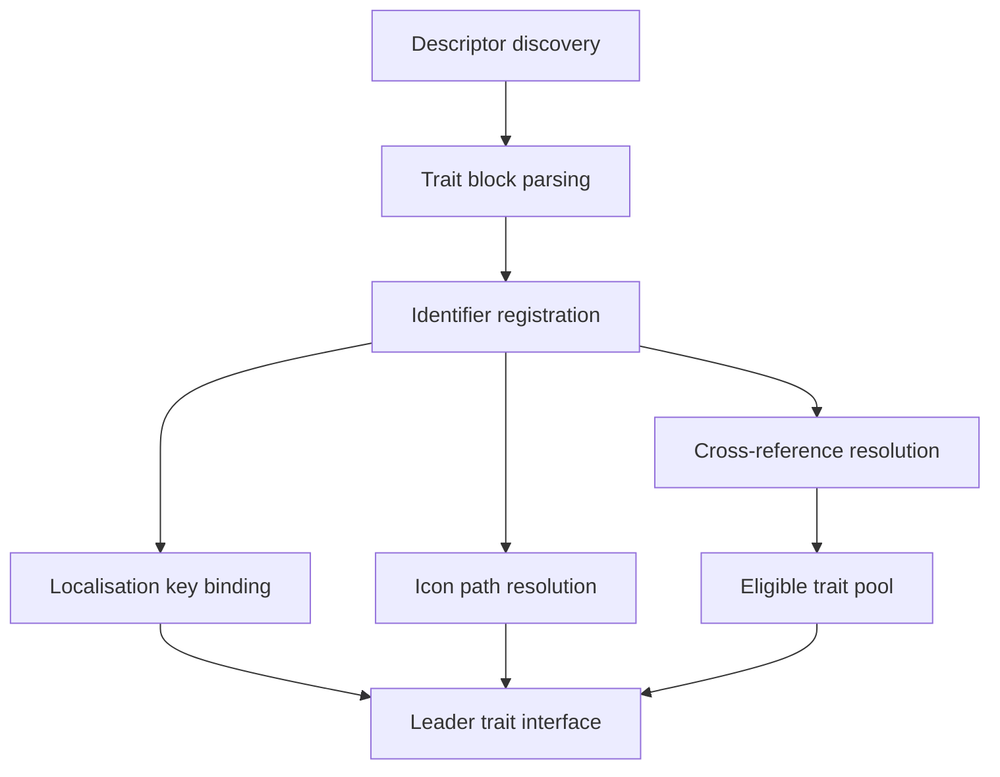

# Architecture (content model deep dive)

This document elaborates the content architecture of the mod. For the system context, architectural style, runtime process, areas, dependency direction, and extension points, see the authoritative [ARCHITECTURE.md](../ARCHITECTURE.md) at the repository root; that material is not reproduced here. This document instead records the load pipeline, namespace behaviour, and override semantics that a future agent needs in order to reason about the content as a resolved dataset rather than as a set of files.

## From files to a resolved trait dataset

The mod's content is only meaningful after four resolution stages performed by the launcher and engine. Each stage has a distinct failure surface.

| Stage | Input | Product | Failure consequence |
|-------|-------|---------|---------------------|
| Descriptor discovery | `ui-character-traits.mod`, payload `descriptor.mod` | Registered mod entry, validated `supported_version` | Mod unregistered or shown as incompatible |
| Trait block parsing | `common/traits/*.txt` | Parsed trait documents | Affected trait dropped; syntax errors may abort the file |
| Identifier registration | Parsed trait documents | Trait identifiers in the leader trait pool | Identifier collisions with vanilla or sibling content |
| Localisation key binding | `localisation/english/*.yml` keys | Display names and descriptions per identifier | Raw identifier shown in place of a name or description |
| Sprite resolution | `ICON` values inside `trait/icon` | Bound sprite, hence texture, or fallback graphic | Placeholder or default icon rendered |
| Cross-reference resolution | `opposites`, `leader_potential_add` trait references | Exclusion set and eligibility predicates | Unresolved exclusions; conditions may never match |

## Namespace behaviour

The mod occupies two namespaces simultaneously:

1. **Its own namespace** — identifiers prefixed `ui_trait_`. Every one of the 47 definitions and every localisation key uses this prefix, so collisions with vanilla content are structurally avoided.
2. **The vanilla namespace by reference** — six vanilla identifiers are referenced by name in
exclusion lists and eligibility conditions: `leader_trait_eager`, `leader_trait_nervous`,
`leader_trait_cautious`, `leader_trait_scout`, `leader_trait_righteous`,
`leader_trait_intellectual`. Seven vanilla *engine* concepts are also referenced by name:
the classes `commander`, `official` and `scientist`, the subclasses
`subclass_commander_admiral` and `subclass_commander_general`, the vanilla governor-focus
trigger `has_any_governor_focus`, and the DLC trigger `has_paragon_dlc`. Three vanilla sprites
are referenced instead of shipping equivalent art: `GFX_leader_trait_engineering_focus`,
`GFX_leader_trait_physics_focus`, `GFX_leader_trait_society_focus`.

Namespace usage is asymmetric: the mod **reads** vanilla identifiers and assets but never **writes** into the vanilla namespace. It also references its own identifiers from within `opposites` and `leader_potential_add` blocks, creating an internal cross-reference graph described in [Eligibility and exclusions](./behaviour/eligibility-and-exclusions.md).

## Override semantics

| Mechanism | Support in this repository | Evidence |
|-----------|---------------------------|----------|
| Adding new definitions | Used | 47 new `ui_trait_*` documents |
| Replacing a vanilla definition | Not used | No file matches a vanilla trait filename |
| Adding a localisation key | Used | 96 keys in one English file |
| Replacing a vanilla localisation key | Not used | No vanilla keys appear in the file |
| Supplying a new sprite definition | Used | `interface/ui_character_traits.gfx` declares 44 sprites over the shipped DDS files |
| Replacing a vanilla icon asset | Not used by filename | Triple-research traits instead reference three vanilla sprites directly |

Ordering is resolved by declaration precedence rather than file order. Because a trait document begins with `ui_trait_x = {`, a later definition of the same identifier would supersede an earlier one. No duplicate identifiers exist in this repository, but the identifier-immutability invariant in [Invariants](./invariants.md) exists precisely because the merge semantics make renaming destructive.

## Content density map

| Component | Files | Lines | Notes |
|-----------|-------|-------|-------|
| Governor traits | 1 | 1017 | 34 of 47 definitions; the largest and most cross-linked area |
| Admiral traits | 1 | 230 | 6 definitions; subclass-gated and fully exclusion-covered |
| Ruler traits | 1 | 176 | 5 definitions; all use `councilor_modifier` |
| Class-agnostic trait | 1 | 43 | 1 definition; the only `self_modifier` trait |
| General trait | 1 | 52 | 1 definition; the only army-scoped and only ethic-required trait |
| Localisation | 1 | 107 | 48 name keys, 48 description keys, 5 comment headings |
| Sprite definitions | 1 | 192 | 44 sprites over 44 referenced DDS files |
| Icons | 45 | n/a | 44 referenced by mod sprites, 3 vanilla sprites referenced, 1 unreferenced |

## Architectural asymmetries worth knowing

- **Icon strategy is mainly self-contained.** 44 of 47 traits render shipped art through the
  mod's own sprites; 3 governor research traits defer to vanilla focus art. One shipped icon
  (`ui_trait_governor_securist.dds`) remains unreferenced.
- **Exclusion coverage is uneven.** 38 traits declare `opposites`; 9 do not. The admiral and
  general areas are fully covered; the ruler area is not.
- **Modifier scoping is explicit and class-aligned.** Every trait names exactly one of
  `planet_modifier` (34), `fleet_modifier` (6), `councilor_modifier` (5), `army_modifier` (1) or
  `self_modifier` (1).
- **Two gating mechanisms coexist.** Admiral, general and ruler traits gate on a Galactic
  Paragons subclass while admitting DLC-less players through `has_paragon_dlc = no`; the
  remaining traits gate only on class, authority, ethic or an existing trait.
- **One trait spans all three classes.** `ui_trait_leader_politically_connected` is available to
  `commander`, `scientist` and `official` alike and excludes only the empire ruler, through
  `is_ruler = no` rather than a class list.

## Related documents

- [ARCHITECTURE.md](../ARCHITECTURE.md) — authoritative high-level architecture
- [Data model](./data-model.md)
- [Flows](./flows/)
- [Invariants](./invariants.md)
