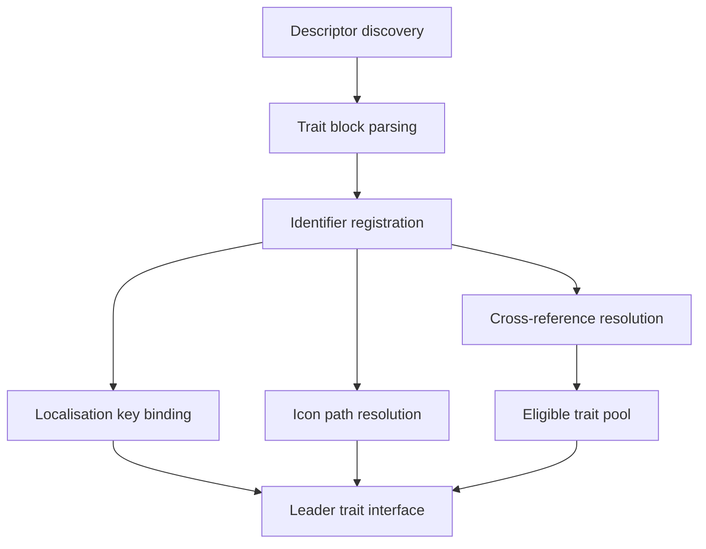

# Architecture (content model deep dive)

This document elaborates the content architecture of the mod. For the system context, architectural style, runtime process, areas, dependency direction, and extension points, see the authoritative [ARCHITECTURE.md](../ARCHITECTURE.md) at the repository root; that material is not reproduced here. This document instead records the load pipeline, namespace behaviour, and override semantics that a future agent needs in order to reason about the content as a resolved dataset rather than as a set of files.

## From files to a resolved trait dataset

The mod's content is only meaningful after four resolution stages performed by the launcher and engine. Each stage has a distinct failure surface.

| Stage | Input | Product | Failure consequence |
|-------|-------|---------|---------------------|
| Descriptor discovery | `ui-character-traits.mod`, payload `descriptor.mod` | Registered mod entry, validated `supported_version` | Mod unregistered or shown as incompatible |
| Trait block parsing | `common/traits/*.txt` | Parsed trait documents | Affected trait dropped; syntax errors may abort the file |
| Identifier registration | Parsed trait documents | Trait identifiers in the leader trait pool | Identifier collisions with vanilla or sibling content |
| Localisation key binding | `localisation/english/*.yml` keys | Display names and descriptions per identifier | Raw identifier shown in place of a name or description |
| Icon path resolution | `icon` fields | Bound texture or fallback graphic | Placeholder or default icon rendered |
| Cross-reference resolution | `opposites`, `leader_potential_add` trait references | Exclusion set and eligibility predicates | Unresolved exclusions; conditions may never match |

## Namespace behaviour

The mod occupies two namespaces simultaneously:

1. **Its own namespace** — identifiers prefixed `ui_trait_`. Every one of the 47 definitions and every localisation key uses this prefix, so collisions with vanilla content are structurally avoided.
2. **The vanilla namespace by reference** — eight vanilla identifiers are referenced by name in exclusion lists and eligibility conditions: `leader_trait_eager`, `leader_trait_nervous`, `leader_trait_cautious`, `leader_trait_scout`, `leader_trait_righteous`, `leader_trait_intellectual`, `leader_trait_governor_erudite`, `leader_trait_architectural_interest`. Three vanilla icon filenames are referenced by path: `trait_natural_engineers.dds`, `trait_natural_physicists.dds`, `trait_natural_sociologists.dds`.

Namespace usage is asymmetric: the mod **reads** vanilla identifiers and assets but never **writes** into the vanilla namespace. It also references its own identifiers from within `opposites` and `leader_potential_add` blocks, creating an internal cross-reference graph described in [Eligibility and exclusions](./behaviour/eligibility-and-exclusions.md).

## Override semantics

| Mechanism | Support in this repository | Evidence |
|-----------|---------------------------|----------|
| Adding new definitions | Used | 47 new `ui_trait_*` documents |
| Replacing a vanilla definition | Not used | No file matches a vanilla trait filename |
| Adding a localisation key | Used | 96 keys in one English file |
| Replacing a vanilla localisation key | Not used | No vanilla keys appear in the file |
| Supplying a new icon asset | Used | 45 DDS files |
| Replacing a vanilla icon asset | Not used by filename | Triple-research traits instead reference vanilla icon paths directly |

Ordering is resolved by declaration precedence rather than file order. Because a trait document begins with `ui_trait_x = {`, a later definition of the same identifier would supersede an earlier one. No duplicate identifiers exist in this repository, but the identifier-immutability invariant in [Invariants](./invariants.md) exists precisely because the merge semantics make renaming destructive.

## Content density map

| Component | Files | Lines | Notes |
|-----------|-------|-------|-------|
| Governor traits | 1 | 653 | 34 of 47 definitions; the largest and most cross-linked area |
| Admiral traits | 1 | 77 | 6 definitions; the only area with a complete icon and exclusion set |
| Ruler traits | 1 | 72 | 5 definitions; all set `modification = no` |
| Class-agnostic trait | 1 | 24 | 1 definition; the only `initial`/`randomized` trait |
| General trait | 1 | 21 | 1 definition; the only spiritualist-gated trait |
| Localisation | 1 | 107 | 48 name keys, 48 description keys, 5 comment headings |
| Icons | 45 | n/a | 8 referenced by mod traits, 3 vanilla paths referenced, 37 unreferenced |

## Architectural asymmetries worth knowing

- **Icon strategy is split.** Only 11 of 47 traits declare an `icon`; 36 inherit an engine default. 8 of those 11 use shipped assets, 3 use vanilla assets. 37 shipped icon files are therefore dead assets.
- **Exclusion coverage is uneven.** 37 traits declare `opposites`; 10 do not. The admiral area is fully covered; the ruler and general areas are not.
- **Modification policy is split by class.** All 39 traits declaring `modification = no` include every governor, general, ruler, and class-agnostic trait except one; no admiral trait declares the field.
- **One trait acts as both a normal trait and a pool member.** `ui_trait_leader_politically_connected` declares `leader_trait = all` and gates itself out of the ruler class through a condition instead of through its `leader_class` list.

## Related documents

- [ARCHITECTURE.md](../ARCHITECTURE.md) — authoritative high-level architecture
- [Data model](./data-model.md)
- [Flows](./flows/)
- [Invariants](./invariants.md)
