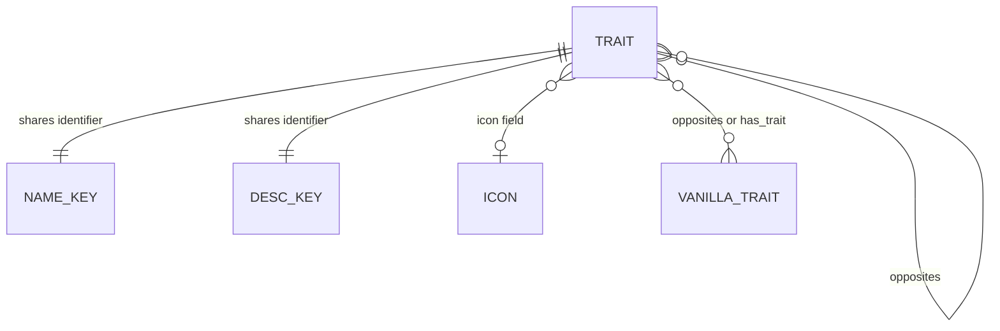

# Data model

## Trait document

A leader trait is a single top-level Clausewitz block keyed by its identifier:

```text
ui_trait_<scope>_<theme> = {
    <field> = <value>
    ...
}
```

The identifier is the document's only key. Everything else is a field. The engine binds the identifier to localisation keys and to any other trait's `opposites` or `leader_potential_add` references.

## Field vocabulary

Only these fields appear across the 47 definitions.

| Field | Form | Declared by | Meaning |
|-------|------|-------------|---------|
| `cost` | Integer literal | 47 of 47 (all `1`) | Trait selection cost |
| `modifier` | Block of `key = value` scalar pairs | 47 of 47 | Static modifiers the engine applies while the leader holds the trait |
| `leader_trait` | Scope list (`{ admiral }`, `{ governor }`, `{ general }`, `{ ruler }`) or the keyword `all` | 47 of 47 | Leader trait pool the document is added to |
| `leader_class` | Class list, e.g. `{ admiral scientist general governor }` | 47 of 47 | Leader classes the trait is offered to |
| `opposites` | Space-separated identifier list, normally quoted | 37 of 47 | Identifiers removed from the same offer |
| `leader_potential_add` | Condition block | 21 of 47 | Eligibility predicates evaluated at offer time |
| `modification` | `no` | 39 of 47 | Blocks genetic/robotic modification of the trait |
| `icon` | Quoted path or vanilla filename | 11 of 47 | Texture reference |
| `initial` | `yes` | 1 of 47 | Trait may be assigned at leader generation |
| `randomized` | `yes` | 1 of 47 | Trait may be drawn during randomised assignment |

### Scope and pool values

| `leader_trait` | `leader_class` | Count |
|----------------|----------------|-------|
| `{ admiral }` | `{ admiral }` | 6 |
| `{ general }` | `{ general }` | 1 |
| `{ governor }` | `{ governor }` | 34 |
| `{ ruler }` | `{ ruler }` | 5 |
| `all` | `{ admiral scientist general governor }` | 1 |

## Modifier vocabulary

98 modifier entries across the corpus use 53 distinct keys. Grouping by target:

| Group | Keys |
|-------|------|
| Ship and fleet | `ship_weapon_damage`, `ship_hull_mult`, `ship_speed_mult`, `ship_fire_rate_mult`, `ship_weapon_range_mult`, `ship_disengage_chance_mult`, `ship_sensor_range_add`, `ship_anomaly_generation_chance_mult`, `science_ship_survey_speed` |
| Army and defence | `army_damage_mult`, `army_morale`, `army_defense_damage_mult`, `planet_army_build_speed_mult` |
| Planet output | `planet_jobs_energy_produces_mult`, `planet_jobs_minerals_produces_mult`, `planet_jobs_alloys_produces_mult`, `planet_jobs_consumer_goods_produces_mult`, `planet_jobs_unity_produces_mult`, `planet_jobs_engineering_research_produces_mult`, `planet_jobs_physics_research_produces_mult`, `planet_jobs_society_research_produces_mult`, `planet_metallurgists_produces_mult`, `planet_chemists_produces_mult`, `planet_culture_workers_produces_mult`, `planet_amenities_mult` |
| Planet social state | `planet_stability_add`, `planet_crime_add`, `planet_immigration_pull_mult`, `pop_happiness`, `pop_growth_speed`, `pop_assembly_speed` |
| Pop upkeep and ethics | `planet_pops_consumer_goods_upkeep_mult`, `planet_pops_robotics_upkeep_mult`, `pop_ethic_authoritarian_attraction_mult`, `pop_ethic_egalitarian_attraction_mult`, `pop_ethic_militarist_attraction_mult`, `pop_ethic_pacifist_attraction_mult`, `pop_ethic_materialist_attraction_mult`, `pop_ethic_spiritualist_attraction_mult`, `pop_ethic_xenophile_attraction_mult`, `pop_ethic_xenophobe_attraction_mult`, `pop_government_ethic_attraction` |
| Construction speed | `planet_building_stronghold_build_speed_mult`, `planet_building_foundry_1_build_speed_mult`, `planet_building_chemical_plant_build_speed_mult`, `planet_district_city_build_speed_mult`, `planet_district_generator_build_speed_mult`, `planet_colony_development_speed_mult` |
| Country | `country_influence_produces_mult`, `country_trust_growth`, `country_admin_cap_add` |
| Leader | `leaders_cost_mult`, `species_leader_exp_gain` |

Modifier values are signed: negative values are liabilities. `ui_trait_governor_hardcore_bureaucrat` deliberately declares a single negative modifier (`country_admin_cap_add = -10`), and several traits pair a positive and negative effect to model a trade-off (for example `ui_trait_governor_deal_with_the_devil` grants `planet_jobs_energy_produces_mult = 0.25` and `planet_crime_add = 25`).

## Identifier relationships



| Relationship | Cardinality | Enforcement |
|--------------|-------------|-------------|
| Trait identifier → name key `ui_trait_x` | 1:1 in practice | Convention only; 1 orphan key observed |
| Trait identifier → description key `ui_trait_x_desc` | 1:1 intended | Convention only; 2 traits lack a description key, 1 orphan key observed |
| Trait identifier → `icon` | 0..1 | 11 traits declare one |
| Trait → trait (`opposites`) | 0..n | 37 traits declare one; every `ui_trait_*` target exists |
| Trait → vanilla trait | 0..n | 8 vanilla identifiers referenced; presence depends on game version |
| Trait → vanilla icon | 0..1 | 3 traits reference vanilla icon paths |

## Schema of the localisation document

`ui-traits_l_english.yml` is a single `l_english:` block containing 96 entries and 5 comment headings:

```yaml
l_english:

# Leader traits
 ui_trait_leader_politically_connected_desc:0 "..."
 ui_trait_leader_politically_connected:0 "Politically Connected"
```

| Aspect | Observation |
|--------|-------------|
| Encoding | UTF-8 with byte-order mark; required by the engine's localisation reader |
| Entry form | ` key:0 "value"` — leading space, version `0`, quoted value |
| Description suffix | `_desc` |
| In-string formatting | `§!` closes the vanilla colour block; `\n` adds a line break |
| Ordering | Description key precedes name key within each group |
| Grouping | Comment headings per leader class: Leader, Admiral, General, Governor, Ruler |

## Trait count reconciliation

| Scope | Definitions | Name keys | Description keys |
|-------|-------------|-----------|------------------|
| Class-agnostic leader | 1 | 1 | 1 |
| Admiral | 6 | 6 | 6 |
| General | 1 | 1 | 1 |
| Governor | 34 | 34 | 32 |
| Ruler | 5 | 5 | 5 |
| Orphan localisation only | 0 | 1 (`ui_trait_governor_securist`) | 0 |
| **Total** | **47** | **48** | **48** |

The two missing description keys are `ui_trait_governor_consumer_industrialist` and `ui_trait_governor_war_industrialist`, both of which have orphaned description keys caused by a spelling error (`idsustrialist` instead of `industrialist`). See [Open questions](./ambiguities-and-open-questions.md).

## Related documents

- [Component: leader traits](./components/leader-traits.md)
- [Component: localisation](./components/localisation.md)
- [Component: icons](./components/icons.md)
- [Eligibility and exclusions](./behaviour/eligibility-and-exclusions.md)
- [Invariants](./invariants.md)
