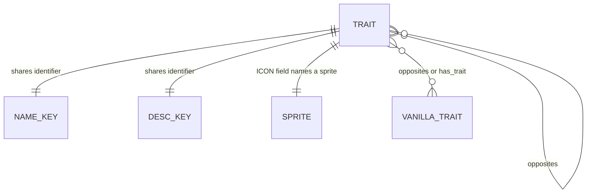

# Data model

## Trait document

A leader trait is a single top-level Clausewitz block keyed by its identifier:

```text
ui_trait_<scope>_<theme> = {
    <field> = <value>
    ...
}
```

The identifier is the document's only key. Everything else is a field. The engine binds the
identifier to localisation keys, to sprite names, and to any other trait's `opposites` or
`leader_potential_add` references.

## Field vocabulary

Only these fields appear across the 47 definitions. Field names and constraints follow the
Stellaris 4.5 leader trait schema documented in the base game's
`common/traits/000_documentation_leader_traits.txt`.

| Field | Form | Declared by | Meaning |
|-------|------|-------------|---------|
| `inline_script` | Call to `trait/icon` with `CLASS`, `ICON`, `RARITY`, `COUNCIL`, `TIER` | 47 of 47 | Builds the layered icon and the trait subtitle |
| `leader_class` | Class list drawn from `commander`, `official`, `scientist` | 47 of 47 | Leader classes the trait is offered to |
| `<scope>_modifier` | Block of `key = value` scalar pairs | 47 of 47 | Modifiers applied while the leader holds the trait, scoped explicitly |
| `opposites` | Identifier list | 37 of 47 | Identifiers the leader may not also hold |
| `leader_potential_add` | Condition block; `THIS` = leader, `FROM` = country | 36 of 47 | Eligibility predicates evaluated at offer time |
| `selectable_weight` | Number, variable or weighted block | 47 of 47 | Relative chance of being offered at level-up |

### Modifier scopes

Each definition names exactly one modifier block. The scope decides where the effect lands:

| Scope | Block | Count | Applies to |
|-------|-------|-------|-----------|
| Planet | `planet_modifier` | 34 | The governed colony |
| Fleet | `fleet_modifier` | 6 | The commanded fleet |
| Council | `councilor_modifier` | 5 | The empire while the leader sits on the council |
| Army | `army_modifier` | 1 | The armies the leader commands |
| Self | `self_modifier` | 1 | The leader itself |

The unscoped `modifier = { }` block is **not** used. It applied to whatever object the leader
was assigned to, which the 4.x scoping model replaced with the explicit blocks above; the
vanilla 4.5 leader trait corpus contains no unscoped `modifier` blocks either.

### Fields deliberately absent

| Field | Why it is absent |
|-------|------------------|
| `cost` | Pre-4.x trait-selection cost; in 4.x only ruler-creation traits declare it, and none of these are ruler-creation traits |
| `modification` | Removed from the leader trait schema |
| `initial`, `randomized` | Removed from the leader trait schema; availability is now expressed through `leader_potential_add` and `selectable_weight` |
| `leader_trait` | Pre-4.x trait pool key; replaced by `leader_class` plus the subclass conditions |
| `icon` (string path) | Replaced by the `trait/icon` inline script and a named sprite |

### Scope and class values

| `leader_class` | Traits | Notes |
|----------------|--------|-------|
| `{ commander }` | 7 | Six admiral-subclass traits plus the general-subclass trait |
| `{ official commander scientist }` | 34 | The governor traits |
| `{ commander scientist official }` | 6 | Five ruler traits plus the shared trait |

## Modifier vocabulary

98 modifier entries across the corpus use 50 distinct keys. Every key is present in the
vanilla 4.5 modifier vocabulary. Grouping by target:

| Group | Keys |
|-------|------|
| Ship and fleet | `ship_weapon_damage`, `ship_hull_mult`, `ship_speed_mult`, `ship_fire_rate_mult`, `ship_weapon_range_mult`, `ship_disengage_chance_mult`, `ship_sensor_range_add`, `ship_anomaly_generation_chance_mult`, `science_ship_survey_speed` |
| Army and defence | `army_damage_mult`, `army_morale`, `army_defense_damage_mult`, `planet_army_build_speed_mult` |
| Planet output | `planet_jobs_energy_produces_mult`, `planet_jobs_minerals_produces_mult`, `planet_jobs_alloys_produces_mult`, `planet_jobs_consumer_goods_produces_mult`, `planet_jobs_unity_produces_mult`, `planet_jobs_engineering_research_produces_mult`, `planet_jobs_physics_research_produces_mult`, `planet_jobs_society_research_produces_mult`, `planet_metallurgists_produces_mult`, `planet_chemists_produces_mult`, `planet_amenities_mult` |
| Planet social state | `planet_stability_add`, `planet_crime_add`, `pop_ethic_xenophile_attraction_mult`, `pop_happiness`, `logistic_growth_mult`, `planet_pop_assembly_mult` |
| Pop upkeep and ethics | `planet_pops_consumer_goods_upkeep_mult`, `planet_pops_robotics_upkeep_mult`, `pop_ethic_authoritarian_attraction_mult`, `pop_ethic_egalitarian_attraction_mult`, `pop_ethic_militarist_attraction_mult`, `pop_ethic_pacifist_attraction_mult`, `pop_ethic_materialist_attraction_mult`, `pop_ethic_spiritualist_attraction_mult`, `pop_ethic_xenophile_attraction_mult`, `pop_ethic_xenophobe_attraction_mult`, `pop_government_ethic_attraction` |
| Construction speed | `planet_building_build_speed_mult`, `planet_building_stronghold_build_speed_mult`, `planet_district_city_build_speed_mult`, `planet_district_generator_build_speed_mult` |
| Country | `country_influence_produces_mult`, `country_trust_growth`, `empire_size_add` |
| Leader | `leaders_cost_mult`, `species_leader_exp_gain` |

Modifier values are signed: negative values are liabilities. `ui_trait_ruler_hardcore_bureaucrat`
deliberately declares a single negative modifier (`empire_size_add = 10`, which raises empire
size), and several traits pair a positive and negative effect to model a trade-off (for example
`ui_trait_governor_deal_with_the_devil` grants `planet_jobs_energy_produces_mult = 0.25` and
`planet_crime_add = 25`).

### Modifiers retired in 4.5

The following pre-4.x modifiers were removed from the game engine and replaced in this mod:

| Retired modifier | Replacement used |
|------------------|------------------|
| `country_admin_cap_add` | `empire_size_add` (inverted sign; the cap concept became an empire-size modifier) |
| `pop_growth_speed` | `logistic_growth_mult` |
| `pop_assembly_speed` | `planet_pop_assembly_mult` |
| `planet_immigration_pull_mult` | `pop_ethic_xenophile_attraction_mult` / `pop_ethic_xenophobe_attraction_mult` (the pull modifier is not registered in 4.5; species-attitude attraction carries the same intent) |
| `planet_culture_workers_produces_mult` | `planet_jobs_unity_produces_mult` (culture workers were folded into unity jobs) |
| `planet_building_foundry_1_build_speed_mult` | `planet_building_build_speed_mult` |
| `planet_building_chemical_plant_build_speed_mult` | `planet_building_build_speed_mult` |

## Identifier relationships



| Relationship | Cardinality | Enforcement |
|--------------|-------------|-------------|
| Trait identifier → name key `ui_trait_x` | 1:1 in practice | Convention only; 1 orphan key observed |
| Trait identifier → description key `ui_trait_x_desc` | 1:1 | Convention only; 1 orphan key observed |
| Trait identifier → sprite | 1:1 | Every trait names a sprite; every sprite resolves |
| Trait → trait (`opposites`) | 0..n | 38 traits declare one; every `ui_trait_*` target exists |
| Trait → vanilla trait | 0..n | 7 vanilla identifiers referenced; presence depends on game version |
| Trait → vanilla sprite | 0..1 | 3 traits reference vanilla focus sprites |

## Schema of the localisation document

`ui-traits_l_english.yml` is a single `l_english:` block containing 96 entries and 5 comment
headings:

```yaml
l_english:

# Leader traits
 ui_trait_leader_politically_connected_desc:0 "..."
 ui_trait_leader_politically_connected:0 "Politically Connected"
```

| Aspect | Observation |
|--------|-------------|
| Encoding | UTF-8 with byte-order mark; required by the engine's localisation reader |
| Entry form | ` key:0 "value"` — leading space, version `0`, quoted value |
| Description suffix | `_desc` |
| In-string formatting | `§!` closes the vanilla colour block; `\n` adds a line break |
| Ordering | Description key precedes name key within each group |
| Grouping | Comment headings per leader class: Leader, Admiral, General, Governor, Ruler |

## Trait count reconciliation

| Scope | Definitions | Name keys | Description keys |
|-------|-------------|-----------|------------------|
| Class-agnostic leader | 1 | 1 | 1 |
| Admiral | 6 | 6 | 6 |
| General | 1 | 1 | 1 |
| Governor | 34 | 34 | 34 |
| Ruler | 5 | 5 | 5 |
| Orphan localisation only | 0 | 1 (`ui_trait_governor_securist`) | 1 |
| **Total** | **47** | **48** | **48** |

The one orphan pair is `ui_trait_governor_securist` / `ui_trait_governor_securist_desc`, which
has no trait definition. See [Open questions](./ambiguities-and-open-questions.md).

## Related documents

- [Component: leader traits](./components/leader-traits.md)
- [Component: localisation](./components/localisation.md)
- [Component: icons](./components/icons.md)
- [Eligibility and exclusions](./behaviour/eligibility-and-exclusions.md)
- [Invariants](./invariants.md)
