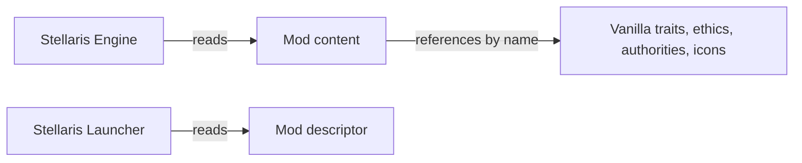

# Dependencies

## Direct dependencies

The repository declares no package, library, framework, or tool dependency of any kind. There is no manifest, lockfile, or dependency-resolution step, because there is nothing to resolve.

| Dependency class | Count |
|------------------|-------|
| Runtime libraries | 0 |
| Development libraries | 0 |
| Build tools | 0 |
| Package managers | 0 |
| Language runtimes | 0 |

## Environmental dependencies

The mod nonetheless depends on external components to function. These are not declared anywhere in the repository; they are implied by the content and its consumption.

| Dependency | Role | Integration boundary | Failure if absent or changed |
|------------|------|----------------------|------------------------------|
| Stellaris game engine | Parses trait definitions, resolves eligibility and exclusions, applies modifiers, renders traits | `common/traits/`, `localisation/english/`, `gfx/interface/icons/traits/` | The content is inert without the engine |
| Stellaris launcher | Reads the descriptor, validates `supported_version`, registers the mod | `ui-character-traits.mod`, `ui-character-traits/descriptor.mod` | Mod is not discoverable or is marked incompatible |
| Clausewitz script parser | Interprets trait blocks and descriptors | Trait definitions and descriptors | Unsupported constructs are ignored or cause parse failure |
| Localisation parser | Reads the YAML localisation file | `localisation/english/ui-traits_l_english.yml` | Missing or malformed key bindings |
| DDS image loader | Loads trait icons | `gfx/interface/icons/traits/` | Unresolvable icon falls back to a default graphic |
| Distribution platform clients | Deliver the packaged mod | Steam, Paradox Mods, Nexus Mods, GitHub | No installation route |
| GitHub Actions runner | Builds the release archive from the tagged content and attaches it to the GitHub release, and publishes the tagged content to Steam Workshop | `.github/workflows/github-release.yml`, `softprops/action-gh-release@v2`, automatic `GITHUB_TOKEN`; `.github/workflows/steam-workshop-release.yml`, `hmlendea/steam-workshop-update@latest`, Steam secrets | No release asset is attached to a published release, or the Workshop item is left behind |

## Vanilla content dependencies

The mod reads base-game content by reference. Unlike declared dependencies these are string couplings that no manifest records, and they change silently when the game updates.

### Referenced vanilla trait identifiers (8)

| Identifier | Kind of reference | Consumers |
|------------|-------------------|-----------|
| `leader_trait_righteous` | `opposites` | `ui_trait_governor_vicious_rumours`, `ui_trait_governor_deal_with_the_devil`, `ui_trait_governor_questionable_ethics` |
| `leader_trait_cautious` | `opposites` | `ui_trait_admiral_berserker`, `ui_trait_admiral_guerillero`, `ui_trait_admiral_glass_cannon` |
| `leader_trait_scout` | `opposites` | `ui_trait_admiral_berserker`, `ui_trait_admiral_guerillero` |
| `leader_trait_nervous` | `opposites` | `ui_trait_admiral_berserker`, `ui_trait_admiral_guerillero` |
| `leader_trait_intellectual` | `opposites` and `has_trait` | `ui_trait_governor_naturalist`; `ui_trait_governor_engineer`, `_physicist`, `_sociologist` |
| `leader_trait_eager` | `opposites` | `ui_trait_leader_politically_connected` |

### Referenced vanilla icon assets (3)

| Path | Consumer |
|------|----------|
| `GFX_leader_trait_engineering_focus` | `ui_trait_governor_engineer` |
| `GFX_leader_trait_physics_focus` | `ui_trait_governor_physicist` |
| `GFX_leader_trait_society_focus` | `ui_trait_governor_sociologist` |

### Referenced vanilla authorities and ethics

| Identifier | References |
|------------|-----------|
| `auth_hive_mind` | 13 |
| `auth_machine_intelligence` | 5 |
| `ethic_fanatic_authoritarian` | 2 |
| `ethic_fanatic_egalitarian` | 1 |
| `ethic_fanatic_militarist` | 1 |
| `ethic_fanatic_materialist` | 2 |
| `ethic_fanatic_pacifist` | 2 |
| `ethic_fanatic_spiritualist` | 2 |
| `ethic_fanatic_xenophile` | 1 |
| `ethic_fanatic_xenophobe` | 2 |
| `ethic_gestalt_consciousness` | 1 |
| `ethic_spiritualist` | 1 |
| `ethic_xenophobe` | 1 |

## Dependency direction

Dependency direction is one-way: the engine and launcher depend on the content, and the content depends on vanilla identifiers by name. The mod has no internal runtime dependency graph, no module graph, and no version constraints to satisfy.

## Version-coupling risk

| Coupling | Verification method | Available now |
|----------|---------------------|---------------|
| Vanilla trait identifiers exist | Manual inspection of the base game's trait files for the declared `supported_version` | No; requires a game installation |
| Vanilla icon paths exist | Manual inspection of the base game's asset directory | No; requires a game installation |
| Authority and ethic identifiers exist | Manual inspection | No; requires a game installation |
| Engine accepts the field vocabulary | In-game load and error-log inspection | No; requires a game installation |

No script, test, or CI check validates any of these couplings. Re-verification is manual and is required on every supported-version change.

## Related documents

- [Compatibility](./compatibility.md)
- [Integrations](./integrations.md)
- [Testing](./testing.md)
- [ARCHITECTURE.md](../ARCHITECTURE.md)
