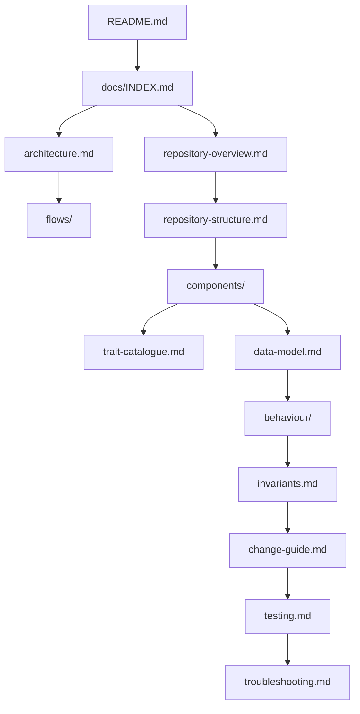

# Documentation maintenance

## Ownership

The repository maintainer owns both the content and this documentation. There is no separate documentation owner, no documentation tooling, and no generated documentation pipeline. Every document under `docs/` is hand-written Markdown.

## Document relationships

| Document | Governance |
|----------|-----------|
| Root documents (`README.md`, `ARCHITECTURE.md`, `CONTRIBUTING.md`, `CODE_OF_CONDUCT.md`, `SECURITY.md`, `PRIVACY.md`) | Governed by their own templates; not duplicated here |
| `docs/INDEX.md` | Must list every document under `docs/`; update when documents are added or removed |
| All other `docs/` documents | Free-form; updated per the matrix below |

## Refresh triggers

| Trigger | Documents to review |
|---------|---------------------|
| Trait added, removed, or modified | `components/trait-catalogue.md`, `components/leader-traits.md`, `data-model.md`, `behaviour/*.md` |
| Field vocabulary changed | `data-model.md`, `components/leader-traits.md` |
| Localisation keys changed | `components/localisation.md`, `data-model.md` |
| Icon assets or references changed | `components/icons.md` |
| Descriptor changed | `components/descriptor.md`, `compatibility.md`, `configuration.md` |
| `supported_version` changed | `compatibility.md`, `dependencies.md`, `testing.md` |
| Vanilla reference added or removed | `dependencies.md`, `compatibility.md`, `integrations.md` |
| Invariant violated or repaired | `invariants.md`, `error-handling.md`, `ambiguities-and-open-questions.md` |
| Build, packaging, or release process changed | `build-and-deployment.md` |
| Test or validation tooling added | `testing.md`, `invariants.md`, `logging.md` |
| Defect found or fixed | `ambiguities-and-open-questions.md`, `troubleshooting.md`, `error-handling.md` |
| Repository structure changed | `repository-structure.md`, `repository-overview.md` |
| Root policy documents revised | `INDEX.md` root document map; the affected `docs/` complement document |

## Verification before committing documentation

| Check | Method |
|-------|--------|
| Every count in `docs/` matches the content | Re-derive counts from `common/traits/`, the localisation file, and the icon directory |
| Every internal link resolves | Verify each relative link target exists |
| Every root-document link resolves | Verify targets against the repository root |
| No document duplicates `ARCHITECTURE.md` | Confirm architectural material is referenced rather than reproduced |
| No code block is empty | Confirm every fenced block has content |
| No placeholder text remains | Search for common placeholder markers |
| Every documented absence is still absent | Confirm `api-reference/`, `concurrency-and-scheduling.md`, and similar files remain unjustified |
| Invariant list matches observed content | Re-run the checks in `testing.md` where practical |

## Evidence standard

Every factual claim in this tree is either:

1. **Directly observed** in the content, with the file and, where useful, the line recorded.
2. **Derived** by counting or cross-referencing, with the derivation described so it can be repeated.
3. **Inferred**, with the inference labelled as such (used primarily in [Design decisions](./design-decisions.md)).
4. **Declared unverifiable**, listed in [Ambiguities and open questions](./ambiguities-and-open-questions.md).

Do not introduce a claim that cannot be assigned to one of these categories. In particular, do not state engine behaviour as fact when it cannot be observed from the repository; record it as an open question instead.

## Known documentation discrepancies

Three statements in the root `ARCHITECTURE.md` do not match direct content analysis:

| Statement | Verified value | Detail |
|-----------|----------------|--------|
| 34 of 45 shipped icons are unreferenced | 37 unreferenced | The root document appears to count the 3 vanilla icon references as shipped icons |
| 3 localisation entries have no matching trait definition | 4 orphaned entries (1 name key, 3 description keys) | Counting basis differs |
| 8 traits omit both `opposites` and `modification`, 5 of which declare `initial`/`randomized` | 1 and 1 respectively | Unsupported by content |

These are recorded in [Ambiguities and open questions](./ambiguities-and-open-questions.md) with evidence. This tree presents the verified values; correcting the root document is a separate action requiring maintainer decision.

## Coverage statement

| Area | Coverage |
|------|----------|
| Trait definitions | Complete — all 47 catalogued with every field |
| Localisation | Complete — all 96 keys, display names, and defects |
| Icons | Complete — all 45 assets and all 11 references |
| Descriptors | Complete |
| Root documents | Referenced, not duplicated |
| Engine behaviour | Described from the mod side; engine-internal semantics marked unverifiable |
| Build, test, CI | Documented as absent, with the consequence stated |

## Related documents

- [INDEX](./INDEX.md)
- [Ambiguities and open questions](./ambiguities-and-open-questions.md)
- [Change guide](./change-guide.md)
- [Testing](./testing.md)
