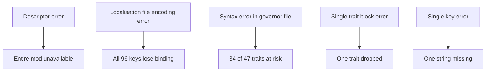

# Error handling

## Principle

The mod contains no error handling because it contains no executable code. Failure is owned by two external components:

- **The Stellaris launcher**, which validates the descriptor and registers the mod.
- **The Stellaris engine**, which parses content, evaluates conditions, and renders the interface.

The repository's only mitigation strategy is deliberate identifier pairing across the definition, localisation, and asset areas, upheld by review.

## Failure taxonomy

| Failure class | Detected by | Player-visible effect | Recoverable in-game |
|---------------|-------------|-----------------------|---------------------|
| Descriptor unreadable | Launcher | Mod not listed | No |
| Version mismatch | Launcher | Mod listed but incompatible | Only by installing a matching game version |
| Path unresolvable | Launcher | Payload not found; mod body missing | No |
| Malformed trait block | Engine parser | Affected trait dropped; possibly the rest of the file | No |
| Duplicate identifier | Engine | Later definition supersedes earlier | No |
| Unknown field in a trait block | Engine | Field ignored, or parse error if the engine rejects it | No |
| Missing localisation name key | Engine | Raw identifier displayed | No |
| Missing localisation description key | Engine | No description shown | No |
| Localisation encoding error | Engine | Entire localisation file may fail to load | No |
| Unresolvable icon path | Engine renderer | Default or placeholder icon | No |
| Unresolved `opposites` identifier | Engine | Intended exclusion never occurs | No |
| Unresolved `has_trait` in eligibility | Engine | Condition never matches; trait may become always or never offered | No |
| Unsupported Clausewitz construct | Engine parser | Field ignored or parse error | No |
| Vanilla identifier removed by a game update | Engine | Exclusion or condition silently inert | No |

## Observed latent defects

These are present in the current revision and represent real, reproducible misbehaviour rather than hypothetical failure.

| Defect | Location | Effect |
|--------|----------|--------|
| Orphaned key pair `ui_trait_governor_securist` / `_desc` | `ui-traits_l_english.yml` | No trait definition binds them; the keys and their icon are inert |
| Orphaned localisation pair `ui_trait_governor_securist` / `_desc` | `ui-traits_l_english.yml` lines 86-87 | Keys bind to nothing; a matching icon file exists unused |
| Unquoted list member `ui_trait_governor_consumer_industrialist` | `ui-traits_leader_governor.txt` line 410 | Inside `ui_trait_governor_war_industrialist`'s `opposites`; the other 7 members are quoted. Parsing outcome unverified |
| Double space before `=` | `ui_trait_governor_chemist = {`, `ui_trait_governor_metallurgist = {` | Cosmetic; no functional effect evidenced |
| Typographical errors in description text | Multiple description values | Displayed text is wrong but parsing is unaffected |
| One-directional exclusion edges | 7 pairs, see [eligibility and exclusions](./behaviour/eligibility-and-exclusions.md) | Effect depends on whether the engine treats `opposites` symmetrically |

## Blast-radius analysis

Because the engine reports errors but the mod cannot react to them, the useful question is how much a single mistake affects.

| Error site | Content at risk |
|------------|-----------------|
| Either descriptor file | 100% of mod content |
| Localisation file encoding | 96 localisation keys |
| `ui-traits_leader_governor.txt` | 34 traits |
| `ui-traits_leader_admiral.txt` | 6 traits |
| `ui-traits_leader_ruler.txt` | 5 traits |
| `ui-traits_leader.txt` | 1 trait |
| `ui-traits_leader_general.txt` | 1 trait |
| A single `icon` value | 1 trait's art |
| A single `opposites` entry | 1 exclusion |

## Diagnostic procedure

No repository-side tooling emits diagnostics. Diagnosis relies on engine output:

1. Check the launcher's mod list for registration and version compatibility.
2. Inspect the Stellaris error log after load. Parse errors and unknown identifiers are reported there.
3. In-game, check the leader trait interface for raw identifiers (missing name key), absent descriptions, or placeholder icons.
4. For exclusion problems, compare the observed offer set against the exclusion lists in the content.

See [Logging and diagnostics](./logging.md) for the available surfaces and [Troubleshooting](./troubleshooting.md) for a symptom-driven guide.

## Defensive practices in the content

The corpus uses several patterns that reduce error likelihood:

| Practice | Example |
|----------|---------|
| Namespaced identifiers | Every identifier carries `ui_trait_` |
| Vanilla identifiers quoted verbatim | `"leader_trait_cautious"` |
| Mod identifiers quoted consistently | 36 of 37 lists quote every member |
| Consistent class/pool pairing | Every trait's two scope fields agree |
| Description entry adjacent to its name entry | Reduces omission risk when adding a trait |

The one deviation from quoting consistency — the unquoted member at line 410 — is the exception that shows the convention is not enforced.

## Related documents

- [Logging and diagnostics](./logging.md)
- [Troubleshooting](./troubleshooting.md)
- [Invariants](./invariants.md)
- [Testing](./testing.md)
