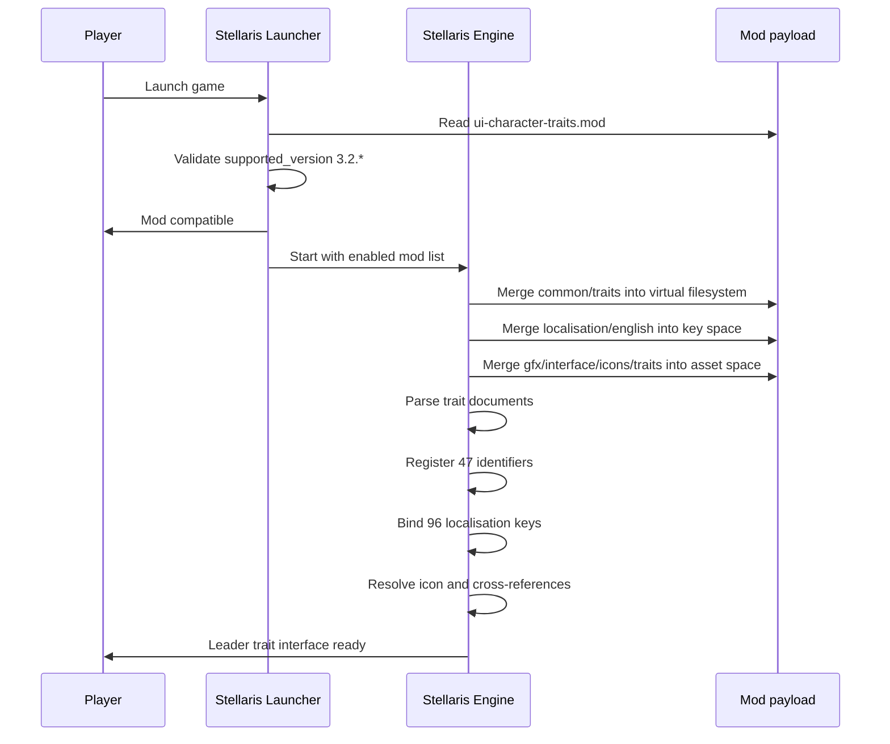

# Flow: game start and content loading

## Trigger

The player launches Stellaris with the mod enabled in the active playset. The flow below reconstructs what the launcher and engine do with this repository's files. The mod contributes no code to any stage.

## Sequence



## Stage detail

### 1. Descriptor discovery

The launcher locates `ui-character-traits.mod` in the mod directory, or `ui-character-traits/descriptor.mod` inside a registered payload. Both declare:

```text
name="Universum Infinitum - Character Traits"
path="mod/ui-character-traits"
tags={ "Characters" }
supported_version="3.2.*"
```

The launcher resolves `path` to the payload directory and validates `supported_version` against the installed game version.

| Outcome | Cause |
|---------|-------|
| Mod listed and enableable | Descriptor readable and version compatible |
| Mod listed but incompatible | `supported_version` does not match the installed version |
| Mod not listed | Descriptor unreadable, `path` unresolvable, or payload absent |

### 2. Filesystem merge

Enabled mod directories are merged into the base game's virtual filesystem. The mod adds:

| Source | Contributes |
|--------|-------------|
| `ui-character-traits/common/traits/` | 5 new files |
| `ui-character-traits/localisation/english/` | 1 new file |
| `ui-character-traits/gfx/interface/icons/traits/` | 45 new image files |

No filename in these directories collides with a vanilla filename, so the merge is purely additive.

### 3. Trait parsing and registration

The engine parses each trait document, then:

1. Registers the 47 identifiers in the leader trait pool.
2. Records each document's `leader_trait` and `leader_class` values for pool membership.
3. Stores `modifier` blocks for later application.
4. Stores `leader_potential_add` condition blocks for offer-time evaluation.
5. Stores `opposites` lists for offer-time subtraction.
6. Records `icon`, `cost`, `modification`, `initial`, and `randomized` flags.

A parse error in one document drops that document; depending on the error class, it may also affect subsequent content in the same file. Because the governor file holds 34 of the 47 definitions, a syntax error there has the largest blast radius.

### 4. Localisation binding

The engine loads `ui-traits_l_english.yml`, splits it on `l_english:`, and binds each key. Binding is by string equality against the trait identifier:

| Condition | Result |
|-----------|--------|
| `ui_trait_x` key present | Trait displays its localised name |
| `ui_trait_x` key absent | Raw identifier displayed instead |
| `ui_trait_x_desc` key present | Tooltip shows the description |
| `ui_trait_x_desc` key absent | No description shown |

Because the file is UTF-8 with a BOM, the encoding must be preserved on edit. A file saved without the BOM, or in another encoding, can prevent the entire localisation file from loading — a single mistake that affects all 96 keys at once.

### 5. Icon and cross-reference resolution

- `icon` values are resolved against the merged filesystem. Mod-shipped paths resolve to mod files; vanilla paths resolve to base-game assets.
- `opposites` entries are resolved against the registered trait set. Mod identifiers resolve at this stage; vanilla identifiers resolve only if the base game defines them.
- Trait references inside `leader_potential_add` (`has_trait = "..."`) are likewise resolved at offer time.

### 6. Interface ready

The leader trait interface and tooltips now render the mod's traits subject to scope, eligibility, and exclusion evaluation described in [Leader trait acquisition](./leader-trait-acquisition.md).

## Failure surfaces

| Stage | Failure mode | Player-visible effect |
|-------|--------------|-----------------------|
| Descriptor discovery | Unreadable descriptor or wrong `path` | Mod missing or incompatible in the launcher |
| Filesystem merge | Filename collision with vanilla | Vanilla content overridden or merged unexpectedly |
| Trait parsing | Syntax error | Affected trait or file dropped |
| Identifier registration | Duplicate identifier | Later definition supersedes the earlier one |
| Localisation binding | Missing or malformed key, wrong encoding | Raw identifiers or missing text |
| Icon resolution | Unresolvable path | Default or placeholder icon |
| Cross-reference resolution | Unknown vanilla identifier | Exclusion or condition never fires |

## Related documents

- [Flow: leader trait acquisition](./leader-trait-acquisition.md)
- [Component: descriptor](./../components/descriptor.md)
- [Error handling](./../error-handling.md)
- [Logging and diagnostics](./../logging.md)
