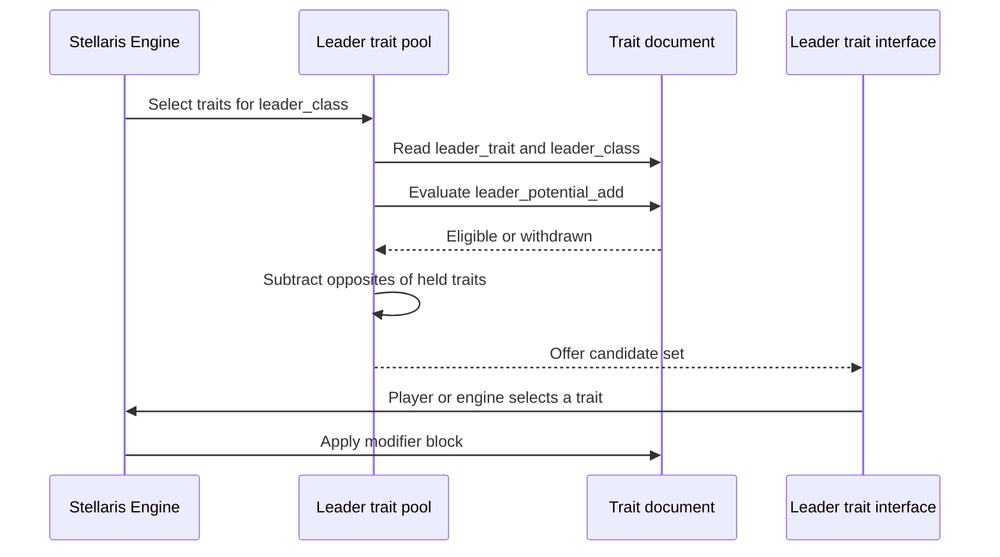

# Flow: leader trait acquisition

## Trigger

A leader is generated, promoted, or offered a trait through an in-game mechanism (level-up choice, leader recruitment, or event). The engine decides which traits to offer. The mod supplies the candidate pool and the rules; it executes nothing.

## Sequence

## Step detail with content examples

### 1. Pool selection

The engine selects candidate traits by matching `leader_class` against the leader, within the pool declared by `leader_trait`.

| Leader | Traits considered |
|--------|-------------------|
| Admiral | 6 admiral traits + `ui_trait_leader_politically_connected` (pool `all`) |
| General | 1 general trait + `ui_trait_leader_politically_connected` |
| Governor | 34 governor traits + `ui_trait_leader_politically_connected` |
| Ruler | 5 ruler traits (the `all`-pool trait is withdrawn by its eligibility condition) |
| Scientist | `ui_trait_leader_politically_connected` alone |

### 2. Eligibility evaluation

For each candidate, the engine evaluates `leader_potential_add` against the leader, the country, and the leader's traits. 21 traits declare such a block.

Worked examples:

| Trait | Condition | Withdrawal case |
|-------|-----------|-----------------|
| `ui_trait_general_crusader` | `FROM = { OR = { has_ethic = "ethic_spiritualist" has_ethic = "ethic_fanatic_spiritualist" } }` | Country is neither spiritualist nor fanatic spiritualist |
| `ui_trait_governor_familist` | `NOT = { from = { has_authority = "auth_hive_mind" } }` | Country is a hive mind |
| `ui_trait_governor_ideologue_militarist` | `NOT = { OR = { FROM = { has_ethic = "ethic_fanatic_pacifist" } FROM = { has_authority = "auth_hive_mind" } } }` | Country is fanatic pacifist or hive mind |
| `ui_trait_governor_engineer` | `NOT = { from = { OR = { has_trait = "leader_trait_intellectual" has_authority = "auth_machine_intelligence" has_trait = "ui_trait_governor_physicist" has_trait = "ui_trait_governor_sociologist" } } }` | Leader has intellectual, country is machine intelligence, or leader already has physicist or sociologist |
| `ui_trait_leader_politically_connected` | `NOT = { leader_class = ruler }`, `NOT = { FROM = { has_ethic = "ethic_gestalt_consciousness" } }` | Leader is a ruler, or country has gestalt consciousness |

A trait with no `leader_potential_add` block (26 of 47) passes this step unconditionally once its scope matches.

### 3. Exclusion subtraction

Traits already held by the leader, plus traits listed in the candidate's `opposites`, are removed from the offer. 37 traits declare exclusions.

Worked examples:

- A general holding nothing but with candidates `ui_trait_admiral_*` scoped away: no exclusion applies, since admiral traits are not admiral-candidates here.
- A governor already holding `ui_trait_governor_moral_authority`: `ui_trait_governor_vicious_rumours` and `ui_trait_governor_deal_with_the_devil` are removed, because both list `ui_trait_governor_moral_authority` in their `opposites`.
- An admiral already holding vanilla `leader_trait_cautious`: `ui_trait_admiral_berserker`, `ui_trait_admiral_guerillero`, and `ui_trait_admiral_glass_cannon` are removed.
- A governor with `leader_trait_righteous` present: `ui_trait_governor_vicious_rumours`, `ui_trait_governor_deal_with_the_devil`, and `ui_trait_governor_questionable_ethics` are removed.

Two traits use eligibility rather than `opposites` to reach the same end: the three research specialists (`engineer`, `physicist`, `sociologist`) never appear together because each rejects the others through `leader_potential_add`.

### 4. Candidate presentation

The surviving set is filtered by the leader-trait UI into the offer the player sees. Traits with `initial = yes` and `randomized = yes` (`ui_trait_leader_politically_connected` only) can also be assigned automatically at leader generation rather than chosen.

### 5. Trait grant and modifier application

On selection, the engine applies the trait's `modifier` block. The trait is recorded on the leader and persisted in the save.

If the trait declares `modification = no` (39 of 47), it cannot subsequently be added or removed through genetic or robotic modification.

## Causal dependencies worth noting

| Dependency | Effect on the flow |
|------------|-------------------|
| Country ethics and authority | Determine eligibility for 20 traits |
| Leader's existing traits | Determine eligibility for 9 `has_trait` references across 3 traits |
| Held traits and `opposites` | Determine offer subtraction for 37 traits |
| Leader class | Determines pool filter and, for one trait, eligibility |
| Vanilla trait existence | Determines whether 14 exclusion references resolve |
| Vanilla icon existence | Determines whether 3 icon references resolve |

## Alternate paths and failures

| Path | Behaviour |
|------|-----------|
| No candidate survives | The leader is offered nothing from this mod; vanilla candidates are unaffected |
| All candidates are excluded | Same as above |
| `opposites` target identifier does not exist | The reference is inert; the intended exclusion does not occur |
| `leader_potential_add` references an unknown identifier | The condition cannot match; the trait is either always or never offered depending on polarity |
| Trait granted, then the mod is removed | The save retains the trait reference; see [State and persistence](./../state-and-persistence.md) |

## Related documents

- [Behaviour: eligibility and exclusions](./../behaviour/eligibility-and-exclusions.md)
- [Behaviour: trait scoping](./../behaviour/trait-scoping.md)
- [Behaviour: modifiers and effects](./../behaviour/modifiers-and-effects.md)
- [Flow: game start and content loading](./game-start-and-content-loading.md)
