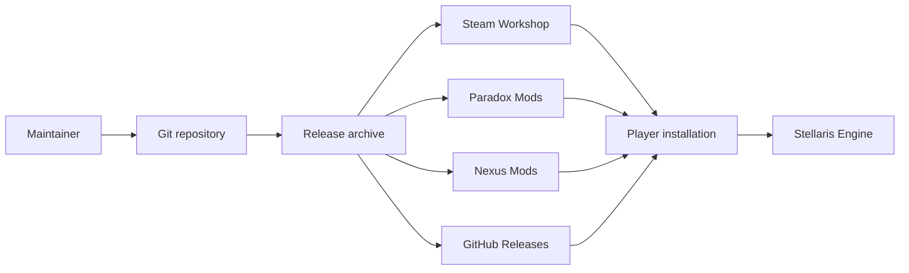

# Security

This document elaborates the security posture of the mod. For the vulnerability reporting, supported-version, scope, and disclosure policy, see the authoritative [SECURITY.md](../SECURITY.md) at the repository root; that material is not reproduced here.

## Threat model

The mod has no runtime trust boundary of its own. It performs no authentication, no authorisation, no input parsing, no network communication, and no file access beyond being read by the game engine. It processes no personal data.

The security-relevant surface is therefore not the mod's behaviour but its **integrity as a distributed artefact**:

Every hop is a place where content could be modified before a player loads it into the game.

## What the engine does with mod content

Trait definitions, localisation, and icons are interpreted by the game, not executed as code. The Clausewitz parser accepts only declarative field assignments and condition blocks. There is no scripting, no callable function, and no facility to run arbitrary logic from a content file. The realistic integrity concerns are therefore limited to:

| Concern | Mechanism | Impact |
|---------|-----------|--------|
| Altered modifier values | Attacker edits a `modifier` block | Gameplay imbalance in an affected installation |
| Altered scope or eligibility | Attacker edits `leader_class`, `leader_potential_add` | Traits become available where intended otherwise |
| Altered localisation | Attacker edits text values | Misleading displayed text |
| Substituted icon asset | Attacker replaces a DDS file | Malicious or inappropriate art displayed |
| Overbroad file replacement | Attacker ships a file that shadows a vanilla file | Base-game content altered, potentially across saves |
| Malformed content | Accidental or deliberate parse error | Affected trait or file dropped |

No content change can execute code, exfiltrate data, or persist outside the game's own save and configuration.

## Mitigations present in the repository

| Mitigation | How it works |
|------------|--------------|
| Namespace isolation | All identifiers carry the `ui_trait_` prefix, so the mod cannot silently claim a vanilla identifier's slot |
| Additive file naming | No file shares a vanilla filename, so vanilla content is not shadowed |
| No executable content | Removes the highest-severity attack class entirely |
| No network behaviour | Removes exfiltration and remote-control classes |
| No personal data | Removes privacy-driven risk |
| Distribution through controlled channels | Steam, Paradox Mods, and GitHub provide integrity and provenance signals |
| Technology-agnostic operation | Because the mod is content-only, its attack surface does not vary by platform |

## Residual risks

| Risk | Severity reasoning | Mitigation status |
|------|--------------------|-------------------|
| Fork or modified copy distributed as the original | Content is text-editable and re-distributable | Documented in `SECURITY.md`: maintainers disclaim downstream forks |
| Unofficial mirrors or repacks | Distribution outside controlled channels | Marked unsupported in `SECURITY.md` |
| Malicious pull request | A contribution could alter modifiers or add shadowing files | Requires reviewer scrutiny; no automated diff gating |
| Release archive mismatch | The release archive is built by `.github/workflows/github-release.yml` from the tagged revision with the automatic `GITHUB_TOKEN`, so it matches the release tag rather than being assembled by hand | Maintainer action is limited to tagging and publishing the release |
| Silent drift between the repository and a distribution channel | Steam Workshop and GitHub Releases publication are automated from the same tag, so both channels receive identical content; Paradox Mods and Nexus Mods remain manual and can lag | Maintainer |
| Silent degradation on game update | A removed vanilla identifier disables an exclusion without an error | Requires re-verification on version change |
| No content validation | Malformed content is caught only by the engine at load time | Manual review |

## Supply-chain posture

| Aspect | Status |
|--------|--------|
| Third-party dependencies | None |
| Build-time execution of external code | None; no build exists |
| Vendored code | None |
| Binary assets committed | 45 DDS icons, 1 PNG thumbnail, 1 PNG cover |
| Secrets in the repository | None |
| Credentials, tokens, or keys | None |
| Automated dependency scanning | Not applicable; no dependencies |
| Release archive provenance | `.github/workflows/github-release.yml` builds the archive from the tagged revision and attaches it to the published release; `.github/workflows/steam-workshop-release.yml` uploads the same tagged content to Steam Workshop |
| SBOM | Not present |
| Signed releases | Not evidenced |

The absence of any executable content and any dependency means the supply chain consists solely of the content itself and the Git history that produced it. This is the mod's principal security strength: there is no code path to compromise.

## Privacy

The mod requests, collects, transmits, and persists no personal data, and has no telemetry, update check, or crash reporting. For the complete statement see [PRIVACY.md](../PRIVACY.md). The game, launcher, operating system, and distribution platforms may have their own data practices, which are outside this mod's control.

## Security-relevant contributor guidance

1. Do not add executable content or scripting to any file. The repository's value derives in part from having none.
2. Do not add a file whose name collides with a vanilla file. Doing so lets the mod shadow base-game content.
3. Do not remove or weaken the `ui_trait_` identifier prefix.
4. Do not commit credentials, tokens, personal data, or internal endpoints. None are required by this project.
5. Review DDS assets contributed by others before merging; binary content is not diffable.
6. Report suspected content-tampering per the process in [SECURITY.md](../SECURITY.md) rather than in a public issue.

## Related documents

- [SECURITY.md](../SECURITY.md) — authoritative policy
- [PRIVACY.md](../PRIVACY.md) — authoritative data statement
- [Integrations](./integrations.md)
- [Dependencies](./dependencies.md)
