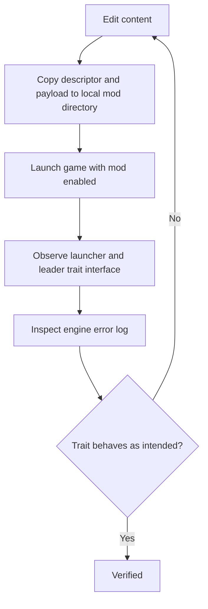

# Testing

## Automated tests

None. The repository contains no test framework, no test files, no test fixtures, no CI workflow, and no assertion harness. The directory listing shows no `tests/`, `test/`, `spec/`, or `.github/workflows/` directory.

| Test category | Status |
|---------------|--------|
| Unit tests | Absent |
| Integration tests | Absent |
| End-to-end tests | Absent |
| Content validation tests | Absent |
| Architecture or fitness tests | Absent |
| Linting configuration | Absent |
| Formatting configuration | Absent |
| Type checking | Absent; no typed language |
| Static analysis | Absent |
| Security scanning | Absent |
| Coverage reporting | Absent |

## Verification strategy

Verification is entirely manual and in-game.

### Manual verification checklist

| # | Check | How |
|---|-------|-----|
| 1 | Descriptor is recognised | The mod appears in the launcher and can be enabled |
| 2 | Version gate passes | The launcher does not mark the mod incompatible |
| 3 | Every trait is present | All 47 traits appear in the leader trait interface for the appropriate leader class |
| 4 | Every trait has a name | No raw `ui_trait_*` string is shown as a trait name |
| 5 | Every trait has a description | The tooltip shows description text |
| 6 | Every declared icon renders | Traits with an `icon` field show the intended art, not a placeholder |
| 7 | Eligibility admits correctly | A trait gated on an ethic or authority appears when the condition is met and is absent otherwise |
| 8 | Eligibility rejects correctly | The same trait is absent when the condition is not met |
| 9 | Exclusions operate | Mutually exclusive traits are not offered together |
| 10 | Modifiers apply | Observed game values change as declared |
| 11 | Modifier scoping holds | Every trait declares exactly one scoped modifier block and no unscoped `modifier` block |
| 12 | Generation policy holds | `ui_trait_leader_politically_connected` can be assigned at leader generation |
| 13 | Error log is clean for this mod | No trait, localisation, or icon errors attributable to this mod |
| 14 | Existing saves still load | A save with mod traits loads and resolves them |

## Static consistency checks a contributor should perform

These checks require no game installation and catch the most common content defects. No repository tooling provides them; they are described so a future contributor can run them by hand or automate them.

| # | Check | Method | Currently violated |
|---|-------|--------|--------------------|
| S1 | Every trait identifier has a matching name key | Extract `ui_trait_*` block identifiers; extract non-`_desc` localisation keys; compare | No |
| S2 | Every trait identifier has a matching `_desc` key | Extract identifiers; extract `_desc` keys with the suffix removed; compare | **Yes** — `ui_trait_governor_consumer_industrialist`, `ui_trait_governor_war_industrialist` |
| S3 | No localisation key lacks a trait | Reverse comparison of S1 and S2 | **Yes** — `ui_trait_governor_securist` |
| S4 | Every `icon` path resolves | Extract `icon` values; check each against shipped files or known vanilla assets | No mod-side violation; 3 vanilla references depend on the base game |
| S5 | Every `opposites` member resolves | Extract `opposites` members; check each against the identifier set or the vanilla set | No mod-side violation; 14 vanilla references |
| S6 | Every `has_trait` reference resolves | Extract `has_trait` values; check against both sets | No mod-side violation |
| S7 | `leader_trait` and `leader_class` agree | Extract both per trait; compare | No |
| S8 | No duplicate identifier | Extract identifiers; check for repeats | No |
| S9 | Descriptor parity | Compare the two descriptor files byte-for-byte | No |
| S10 | Localisation encoding | Confirm UTF-8 with BOM | No |
| S11 | No file shadows a vanilla filename | Compare filenames against vanilla conventions | No |
| S12 | Localisation file parses as expected YAML | Inspect structure and entry form | Not verified; the file uses the engine's `key:0 "value"` form rather than standard YAML mapping |

## Coverage gaps

| Gap | Consequence |
|-----|-------------|
| No identifier-versus-key checking | The two missing `_desc` keys and one orphaned key pair went undetected |
| No icon reference checking | 37 of 45 shipped icons are unused and nothing flags it |
| No exclusion graph checking | Seven one-directional exclusion edges are undetected |
| No vanilla reference checking | Version-coupled identifiers cannot be validated without a game installation |
| No parse validation | Syntax errors surface only at game load |
| No automated regression protection | Any content change relies entirely on manual re-verification |

## Test data

Should tests ever be introduced, the repository currently contains no fixtures. Trait identifiers, localisation keys, and modifier keys are drawn from the game domain rather than from general-purpose test values.

## Recommended first automation

The highest-value, lowest-cost additions, in order:

1. A script that performs checks S1-S3 (identifier and localisation key pairing). This directly catches three live defects.
2. A script that performs S4-S6 (icon and cross-reference resolution). This prevents silent exclusion and icon failures.
3. A workflow that runs the scripts on push and pull request, since none exists today.

## Related documents

- [Invariants](./invariants.md)
- [Logging and diagnostics](./logging.md)
- [Troubleshooting](./troubleshooting.md)
- [Change guide](./change-guide.md)
