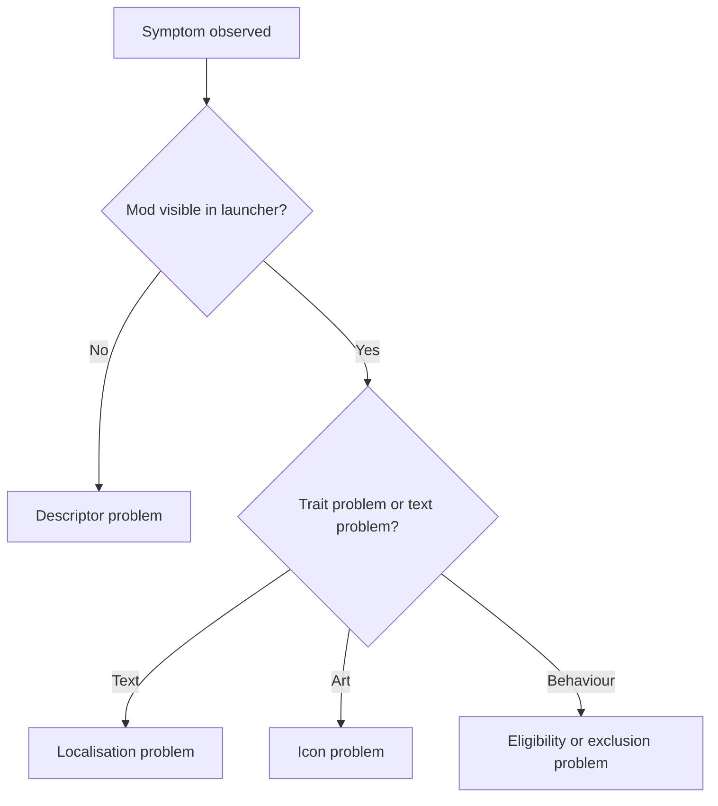

# Troubleshooting

## How to diagnose

The mod emits nothing, so diagnosis depends entirely on observable symptoms. Work from the symptom table below, then follow the linked procedure.

## Symptom table

| Symptom | Probable cause | Resolution |
|---------|----------------|------------|
| Mod absent from the launcher playset | Descriptor unreadable, or `path` does not resolve to the payload directory | Confirm `ui-character-traits.mod` exists at the mod-directory root and the payload directory is named `ui-character-traits`. Compare the two descriptor files. |
| Mod listed but marked incompatible | `supported_version="v4.5.*"` does not match the installed game version | Install a 4.5.x build, or update `supported_version` in both descriptors to an evidenced-compatible range |
| A trait shows a raw `ui_trait_*` string as its name | The localisation name key is missing or misspelled | Compare the identifier against the localisation file; keys must match exactly |
| A trait shows a name but no description | The `_desc` key is missing or misspelled | Check that the `_desc` key matches the identifier exactly; no such defect exists today |
| All localisation strings missing at once | The localisation file lost its UTF-8 BOM or failed to parse | Confirm UTF-8 with BOM; confirm the `l_english:` root block and the `key:0 "value"` entry form |
| A trait shows a generic or placeholder icon | The `ICON` sprite does not resolve | Confirm the sprite is declared in `interface/ui_character_traits.gfx` and the DDS file it names exists, or that the vanilla sprite exists in the installed game version |
| A trait never appears for any leader | `leader_class` excludes the class, or `leader_potential_add` never matches | Inspect the trait's `leader_class`, `leader_trait`, and eligibility block |
| A trait appears for the wrong leader class | `leader_class` and `leader_trait` disagree | Make the two fields consistent; note that file placement is not authoritative |
| A trait disappears only for some empires | An eligibility condition matches | Inspect the `leader_potential_add` block, particularly hive-mind, machine-intelligence, and fanatic-ethic exclusions |
| Two conflicting traits are both offered | The exclusion entry is missing, one-directional, or references a nonexistent identifier | Inspect both traits' `opposites` lists; verify the target exists |
| An exclusion that used to work stopped working after a game update | A referenced vanilla identifier was renamed or removed | Re-verify the vanilla references listed in [Dependencies](./dependencies.md) |
| Modifier effects are not observable in game | The trait is not actually held, or the modifier key is not recognised | Confirm the trait is held; confirm the key appears elsewhere in the corpus |
| One trait edit broke many traits | A syntax error in the governor file, which holds 34 of 47 definitions | Inspect the edited block for unbalanced braces; check the engine error log |
| An existing save fails to resolve a trait | The trait identifier was renamed or the definition removed | Restore the identifier or re-add the definition; see [State and persistence](./state-and-persistence.md) |

## Procedure: descriptor problem

1. Confirm both descriptor files exist: `ui-character-traits.mod` at the repository root and `ui-character-traits/descriptor.mod`.
2. Compare the two files byte-for-byte. They must be identical.
3. Confirm the `path` value's final segment matches the payload directory name (`ui-character-traits`).
4. Confirm the payload contains `common/`, `gfx/`, and `localisation/`.
5. Re-extract from a release archive if the installation is suspect.

## Procedure: localisation problem

1. Confirm the file is `localisation/english/ui-traits_l_english.yml` — the directory name and filename pattern both matter.
2. Confirm the encoding is UTF-8 **with** BOM.
3. Confirm the root block is `l_english:` and nothing precedes it that could break parsing.
4. Confirm each entry uses one leading space, the key, `:0`, and a double-quoted value.
5. Confirm every trait has both a name key and a `_desc` key, spelled exactly like the identifier.
6. Search for orphaned keys: keys with no matching trait definition.

## Procedure: icon problem

1. Extract every `ICON` value from the `trait/icon` blocks in `common/traits/*.txt`.
2. For each `GFX_` value, confirm a `spriteType` with that name exists either in
   `interface/ui_character_traits.gfx` or in a vanilla `interface/*.gfx` file.
3. For each mod sprite, confirm the `texturefile` it names exists on disk.
3. For any value that is not shipped by the mod, confirm the base game supplies that asset for the installed version.
4. Confirm the asset is DDS and sits directly in `traits/`, not in a subdirectory.

## Procedure: behaviour problem

1. Determine the trait's scope from `leader_trait` and `leader_class`.
2. Evaluate its `leader_potential_add` block against the observed empire: ethics, authority, and the leader's existing traits.
3. Evaluate its `opposites` list against the traits the leader already holds.
4. Check the reverse direction: whether other traits exclude this trait.
5. If the trait should be present but is not, work backwards through scope, eligibility, then exclusions.
6. Check the engine error log for unresolved identifier reports.

## Procedure: parse failure

1. Identify the most recently edited file. The governor file holds 34 of 47 definitions and therefore has the largest blast radius.
2. Inspect the edited block for unbalanced braces. Every trait block opens with `= {` and must close with a matching `}`.
3. Confirm no stray character terminates a block early.
4. Confirm the block header form `identifier = {` is intact; note that two existing traits use a double space before `=` (`ui_trait_governor_chemist`, `ui_trait_governor_metallurgist`) and parse correctly.
5. Consult the engine error log for the reported line.

## Known defects that can mimic symptoms

| Defect | Symptom it produces |
|--------|---------------------|
| `ui_trait_governor_securist` localisation orphaned | Nothing visible; the pair is inert |
| 1 unreferenced icon file (`ui_trait_governor_securist.dds`) | Nothing visible; the asset is inert |
| Unquoted `opposites` member at line 410 | Unverified; may cause the exclusion to be malformed |
| Seven one-directional exclusion edges | Possibly allows traits to coexist that were intended to be exclusive |

## Escalation

If a symptom persists after these procedures, the cause is likely engine-internal or version-related rather than a content defect. Consult the Stellaris error log directly. For suspected content tampering, follow the process in [SECURITY.md](../SECURITY.md).

## Related documents

- [Error handling](./error-handling.md)
- [Logging and diagnostics](./logging.md)
- [Compatibility](./compatibility.md)
- [Change guide](./change-guide.md)
